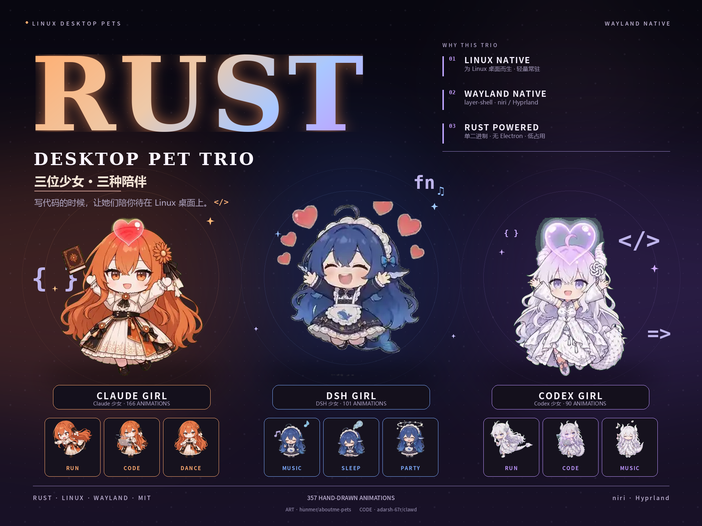

<div align="center">
  
</div>

<div align="center">
  <video src="docs/2026-11-12-223118-REGION.mp4" controls playsinline preload="metadata" width="100%"></video>
  <p><a href="docs/2026-11-12-223118-REGION.mp4">▶ Watch the demo · 观看演示</a></p>
</div>

<h1 align="center">Rust Desktop Pet Trio</h1>

<p align="center">
  <b>Three little companions, living natively on your Linux desktop.</b><br>
  <b>三位少女，三种陪伴，原生住在你的 Linux 桌面上。</b>
</p>

<p align="center">
  <code>Rust 2024</code> · <code>Linux</code> · <code>Wayland</code> · <code>layer-shell</code> · <code>357 animations</code> · <code>MIT</code>
</p>

---

## English

### Three girls, one native Linux desktop

**Rust Desktop Pet Trio** is a collection of three independent desktop pets for Linux, all written in **Rust**:

- **Claude Girl** — warm orange, 166 hand-drawn animation clips.
- **DSH Girl** — deep ocean blue, 101 hand-drawn animation clips.
- **Codex Girl** — silver violet, 90 hand-drawn animation clips.

Each pet is a small, transparent, always-on-top **Wayland layer-shell** window that lives at the bottom of the screen. They idle, wander, react when you click them, notice when your battery is low, dance when music is playing, and keep you company while you code.

There is no Electron, no browser engine, no X11 fallback, and no background daemon. Just three Rust binaries, 357 hand-drawn 10-second clips, and a state machine that tries to feel alive.

### Why Rust, why Linux, why Wayland

This project is built around three hard requirements.

**Rust, because a desktop pet should be invisible in the process list.** All three pets use Rust 2024 and compile to a single executable of roughly 2 MB with `strip`, LTO, and `opt-level = "s"`. There is no garbage collector, no JavaScript runtime, and no bundled browser. The renderer blits one 640×360 RGBA frame into a shared-memory buffer; the sensors run on ordinary threads. Memory use stays small and predictable while the pet is on screen all day.

**Linux, because that is where these pets live.** The code talks directly to Linux interfaces: `/proc` for process detection, sysfs for battery state, D-Bus/MPRIS for music, the XDG base directories for config and media, and systemd user services for optional autostart. There is no Windows or macOS build, and no plan to pretend otherwise.

**Wayland, because layer-shell is the right primitive.** Each pet creates a `zwlr_layer_shell_v1` overlay surface with a transparent buffer, fractional-scale awareness, click-through transparency, and an input region built from the visible pixels. The tested compositors are **niri** and **Hyprland**; other wlr-layer-shell compositors may work, but focus detection falls back to "no focus information". This is a Wayland-native project, not an XWayland app.

### The trio

| Pet | Directory | Binary | Animations | Palette | Click-happy clip | Walk movement |
| --- | --- | --- | ---: | --- | --- | --- |
| **Claude Girl** | `claude-girl/` | `claude-girl` | 166 | warm orange / copper | 4.0–10.0 s (6 s) | 3.0–5.0 s, 120 px |
| **DSH Girl** | `dsh-girl/` | `dsh-girl` | 101 | deep blue / silver | 3.5–10.0 s (6.5 s) | 1.5–4.5 s, 180 px |
| **Codex Girl** | `codex-girl/` | `codex-girl` | 90 | silver white / violet | 3.0–10.0 s (7 s) | 3.0–5.5 s, 150 px |

The three projects share the same engine and the same pose vocabulary, but each animation set has its own rhythm. The click-happy start and the walk movement window are therefore tuned separately, so each character reaches her jump and her run at the right moment. Every animation file itself is still a complete 10-second clip.

### Shared features

- **357 hand-drawn animations.** Each pose is a 5120×5400 WebP sprite sheet: 8 columns × 15 rows, 120 frames of 640×360 at 12 fps, played as one complete 10-second loop.
- **Native Wayland overlay.** `zwlr_layer_shell_v1`, fractional scaling, transparent background, click-through outside the artwork, input region derived from opaque pixels.
- **AI-coding awareness.** Focus detection through niri IPC or the Hyprland socket, plus `/proc` scanning for `claude`, `opencode`, and `codex`. When you focus an AI CLI, the pet switches to work mode.
- **A small daily routine.** Work mode types along and takes music breaks; awake mode idles, looks around, picks a random animation, and walks; rest mode gets drowsy and falls asleep.
- **Small reactions.** Happy hop on click, celebration when the charger is plugged in, low-battery reminder, late-night yawn, dance when MPRIS reports music, quiet "copy" animation when the clipboard changes.
- **Walking with wall awareness.** The window moves only during the run window of the clip. Direction cycles two left runs, then two right runs; if the wall is closer than half a stride, the pet flips direction instead of running in place.
- **Readable architecture.** Pet engine, Wayland host and sensors are separate modules. No framework, no runtime, no magic.
- **Configuration and click commands.** A small JSON file controls polling, terminal commands, and click actions; commands are split on whitespace and spawned directly, with a 1200 ms click debounce.

### Requirements

- Linux with a Wayland compositor that supports `zwlr_layer_shell_v1`. **niri** and **Hyprland** are the tested targets. X11 is not supported.
- Rust 1.85 or newer, because all three crates use edition 2024.
- `pkg-config`, `wayland`, and `wayland-protocols` development files.
- Optional: a working D-Bus session bus for MPRIS music detection.
- Optional: `wl-clipboard` support for the clipboard reaction.

On Arch Linux:

```bash
sudo pacman -S --needed rust pkg-config wayland wayland-protocols
```

### Build

Build all three from the collection root:

```bash
cd /home/LinXuan/.local/opt/linux-desktop-pet
for pet in claude-girl dsh-girl codex-girl; do
  cargo build --release --manifest-path "$pet/Cargo.toml"
done
```

Or build one at a time:

```bash
cd claude-girl && cargo build --release
cd dsh-girl && cargo build --release
cd codex-girl && cargo build --release
```

The binaries are written to:

```text
claude-girl/target/release/claude-girl
dsh-girl/target/release/dsh-girl
codex-girl/target/release/codex-girl
```

### Run

Run one pet from its own project directory, so it can find its local config and media:

```bash
cd claude-girl
./target/release/claude-girl
```

Run all three together in the background. This fish version detaches each process with `setsid`, so you can close the terminal immediately:

```fish
for p in codex-girl claude-girl dsh-girl; pkill -x $p 2>/dev/null; env -C /home/LinXuan/.local/opt/linux-desktop-pet/$p setsid -f ./target/release/$p </dev/null >/dev/null 2>&1; end
```

The same command for bash:

```bash
for p in codex-girl claude-girl dsh-girl; do
  pkill -x "$p" 2>/dev/null
  (cd "/home/LinXuan/.local/opt/linux-desktop-pet/$p" && setsid -f "./target/release/$p" </dev/null >/dev/null 2>&1)
done
```

Check that all three are alive:

```bash
pgrep -a -x 'codex-girl|claude-girl|dsh-girl'
```

Stop all three:

```bash
pkill -x 'codex-girl|claude-girl|dsh-girl'
```

Three pets on one screen may overlap. That is expected; they are independent windows.

### Deploy the launcher (recommended)

Keep the whole repository at:

```text
~/.local/opt/linux-desktop-pet
```

Install the single-file launcher to:

```text
~/.local/bin/pet
```

From an existing checkout, install the launcher with one command:

```bash
install -Dm755 pet ~/.local/bin/pet
```

For a fresh clone, this one-liner creates both directories, clones the repository, and installs the launcher (replace `YOUR_REPO_URL`):

```bash
mkdir -p ~/.local/opt ~/.local/bin && git clone YOUR_REPO_URL ~/.local/opt/linux-desktop-pet && install -Dm755 ~/.local/opt/linux-desktop-pet/pet ~/.local/bin/pet
```

The `pet` file in the repository is the source copy. Edit that one and reinstall it; do not edit `~/.local/bin/pet` directly.

Build the three binaries once (these commands work in fish and bash), then start or stop each pet by name:

```bash
cargo build --release --manifest-path "$HOME/.local/opt/linux-desktop-pet/claude-girl/Cargo.toml"
cargo build --release --manifest-path "$HOME/.local/opt/linux-desktop-pet/dsh-girl/Cargo.toml"
cargo build --release --manifest-path "$HOME/.local/opt/linux-desktop-pet/codex-girl/Cargo.toml"
```

```bash
pet claude
pet codex
pet dsh
```

Running the same command again closes that pet. The launcher expects the repository at `~/.local/opt/linux-desktop-pet`; if you keep it elsewhere, set `PET_ROOT`:

```bash
PET_ROOT=/path/to/linux-desktop-pet pet claude
```

Startup errors are written to `~/.local/state/pet/<name>.log`.

### Install a standalone binary (optional)

Skip this section if you use the `pet` launcher above. Install one pet into your user prefix:

```bash
pet=claude-girl
install -Dm755 "$pet/target/release/$pet" ~/.local/bin/"$pet"
mkdir -p ~/.local/share/"$pet"
cp -r "$pet/media" ~/.local/share/"$pet"/
```

The binary searches for `media/anim` in this order:

1. `$XDG_DATA_HOME/<pet>/media` (usually `~/.local/share/<pet>/media`)
2. `media/` next to the executable
3. `../media`
4. `../../media`
5. `./media`

If you want the pet to start with your graphical session, create a user service. Replace `claude-girl` with `dsh-girl` or `codex-girl` as needed:

```bash
mkdir -p ~/.config/systemd/user
cat > ~/.config/systemd/user/claude-girl.service <<'SERVICE'
[Unit]
Description=Claude Girl desktop pet
After=graphical-session.target
PartOf=graphical-session.target

[Service]
ExecStart=%h/.local/bin/claude-girl
Restart=on-failure

[Install]
WantedBy=graphical-session.target
SERVICE
systemctl --user daemon-reload
systemctl --user enable --now claude-girl.service
```

### Configuration

All three pets read one file:

```text
$XDG_CONFIG_HOME/desktop-pet/desktop-pet.json
# usually ~/.config/desktop-pet/desktop-pet.json
```

The file has shared polling settings and one `click` block per pet:

```json
{
  "poll": { "systemState": 2500, "cursor": 33 },
  "pets": {
    "claude-girl": {
      "click": { "left": "", "middle": "kitty", "right": "kitty claude" }
    },
    "dsh-girl": {
      "click": { "left": "", "middle": "kitty", "right": "kitty dsh-tui" }
    },
    "codex-girl": {
      "click": { "left": "", "middle": "kitty", "right": "kitty codex" }
    }
  }
}
```

Each binary selects `pets.<package-name>` and falls back to built-in defaults for missing keys, so you only need to keep the sections you want to change.

| Key | Default | Meaning |
| --- | --- | --- |
| `poll.systemState` | `2500` | Sensor poll interval, in milliseconds. |
| `poll.cursor` | `33` | Render tick, in milliseconds. |
| `click.left` | `""` | Left-click command. Empty means no command; the click still plays the happy reaction. |
| `click.middle` | `kitty` | Middle-click command. |
| `click.right` | per pet | `kitty claude` for Claude Girl, `kitty dsh-tui` for DSH Girl, `kitty codex` for Codex Girl. |

Commands are split on whitespace and spawned directly, without a shell. If you need pipes or quoting, point the config at a small wrapper script. Click commands are debounced for 1200 ms, so a burst of clicks cannot open a terminal swarm. The file is read at startup; restart the pet after editing.

### How it works

```text
sensors (2.5 s) ──► DerivedState ──► Pet state machine ──► pose ──► renderer (33 ms)
focus socket ─────► SharedCache ───┘
clipboard ────────► reaction ──────┘
```

- **Sensors.** A background thread polls focused window, CLI process count, MPRIS playback, battery and hour every 2.5 seconds. A compositor-specific thread streams focus events into a shared cache.
- **Pet engine.** Each pose is locked for a complete 10-second clip. A click interrupts immediately; charging, copy and other reactions wait for the current clip to finish. The awake routine is seven steps: idle, idle, random, idle, idle, random, walk.
- **Walking.** The window is stationary before and after the run window, interpolates its position during the run, clamps at the screen edges, and flips direction when the remaining distance is shorter than half a stride.
- **Renderer.** `Sheet` loads WebP sprite sheets lazily, keeps a small LRU cache, pins the click-happy sheet, and blits one 640×360 frame into the shared-memory buffer. The layer surface stays transparent; the input region follows the visible pixels.

### Animation format

Each file in `<pet>/media/anim/` is a WebP sprite sheet:

- **5120×5400** pixels, **8 columns × 15 rows**
- **120 frames** of **640×360**, played at **12 fps** = **10 seconds**
- Transparent background; the artwork is padded inside each cell

The dedicated pose mapping used by Claude Girl and DSH Girl:

| Pose | Source clip |
| --- | --- |
| `idle` | `待机呼吸休闲` |
| `happy` | `点击回应-开心跃动` |
| `dance` | `可爱宅舞` |
| `typing` | `写代码` |
| `music` | `悠闲哼歌` |
| `walk-left` / `walk-right` | `原地左转奔跑` (right is mirrored) |
| `copy` | `轻快记录` |
| `charging` | `工作状态-雀跃庆祝` |
| `low-battery` | `工作状态-垂头叹气冒汗` |
| `late-night` / `drowsy` | `哈欠连天` |
| `asleep` | `原地小憩沉眠` |

Codex Girl uses the same states with her own clip names: `待机`, `开心`, `跳舞`, `写代码`, `听音乐`, `奔跑`, `记录`, `庆祝`, `没电`, `打哈欠`, `睡觉`.

To add a random animation, put a new WebP in `media/anim/` and add its filename stem to `EASTER_ACTIONS` in `src/pet.rs`. To add a dedicated state, map the new stem in `pose_anim` in `src/gfx.rs`.

### Project layout

```text
linux-desktop-pet/
├── README.md                 this document
├── LICENSE                   MIT license for the code
├── .gitignore                build artifacts and legacy configs
├── pet                       one-file start/stop launcher
├── docs/
│   └── poster.png            trio poster (4:3)
├── claude-girl/
│   ├── src/
│   │   ├── main.rs           entry point, sensor threads, main loop
│   │   ├── pet.rs            pose scheduler and state machine
│   │   ├── gfx.rs            WebP sheet loader and compositor
│   │   ├── host/             Wayland layer-shell host
│   │   └── sensors/          focus, MPRIS, battery, clipboard, /proc
│   ├── media/anim/           166 WebP animation sheets
│   ├── docs/poster.png
│   ├── README.md
│   └── LICENSE
├── dsh-girl/                 same layout, 101 animations
└── codex-girl/               same layout, 90 animations
```

### Troubleshooting

- **`no media/anim directory`** — run the binary from its project directory, or install `media/` into `~/.local/share/<pet>/media`.
- **The pet is invisible or the layer never appears** — check that you are on Wayland and that your compositor supports `zwlr_layer_shell_v1`. niri and Hyprland are the tested targets.
- **Nothing happens under X11** — X11 is not supported. This is a Wayland-native application.
- **Focus reactions do not fire** — focus detection is implemented for niri and Hyprland. Other compositors fall back to no focus information.
- **No music reaction** — make sure the player exposes MPRIS on the session bus.
- **No clipboard reaction** — make sure `wl-clipboard` support is available.
- **Clicks open terminals unexpectedly** — edit the `click` section of the config. Commands are split on whitespace and spawned without a shell.
- **The three pets overlap** — they are independent windows; overlapping is normal.

### License

The source code in this repository is released under the **MIT License** — see [LICENSE](LICENSE).

**Asset notice.** The character artwork and animation frames in `*/media/anim/` are **not** covered by the MIT license. They come from the [aboutme-pets](https://github.com/hunmer/aboutme-pets) project. Please follow the upstream asset terms; for public redistribution, credit the upstream project. Do not use the artwork commercially without permission.

### Credits

- **Original concept and static-pose state machine:** [adarsh-67r/clawd](https://github.com/adarsh-67r/clawd) (MIT). These pets began as a port of clawd's state machine from static PNG poses to 10-second WebP clips.
- **Character art and animation clips:** [hunmer/aboutme-pets](https://github.com/hunmer/aboutme-pets). Claude Girl, DSH Girl and Codex Girl use the Claude, DSH and Codex spritesheets from that project.
- **Rust ecosystem:** `wayland-client`, `wayland-protocols`, `wayland-protocols-wlr`, `zbus`, `image`, `wl-clipboard-rs`, `serde`, `chrono`.
- The trio poster is composited from the projects' own animation frames.

---

## 中文

### 三位少女，一个原生 Linux 桌面

**Rust 桌宠三重奏** 是三个独立的 Linux 桌面宠物，全部用 **Rust** 编写：

- **Claude Girl** — 暖橙色，166 段手绘动画。
- **DSH Girl** — 深海蓝，101 段手绘动画。
- **Codex Girl** — 银白紫，90 段手绘动画。

每只桌宠都是一个透明、置顶的 **Wayland layer-shell** 窗口，常驻在屏幕底部。她们会发呆、会散步、被点击时会开心跳一下、电量低时会提醒你、有音乐时会跳舞，也会在你写代码时安静陪着你。

没有 Electron，没有浏览器内核，没有 X11 兜底，也没有后台守护进程。只有三个 Rust 可执行文件、357 段手绘的 10 秒动画，和一个努力让自己“活着”的状态机。

### 为什么是 Rust，为什么是 Linux，为什么是 Wayland

这个项目围绕三个硬要求构建。

**用 Rust，因为桌宠不该出现在进程列表的存在感里。** 三只桌宠都使用 Rust 2024，开启 `strip`、LTO 和 `opt-level = "s"` 后，每只约为 2 MB 的单文件可执行程序。没有垃圾回收器，没有 JavaScript 运行时，也没有捆绑浏览器。渲染器只把一帧 640×360 的 RGBA 画面送进共享内存缓冲区，传感器跑在普通线程上。即使常驻一整天，内存占用也小而稳定。

**为 Linux，因为这些桌宠就住在这里。** 代码直接使用 Linux 接口：`/proc` 识别进程，sysfs 读取电池，D-Bus/MPRIS 获取音乐，XDG 目录读取配置和素材，systemd 用户服务负责可选的开机自启。没有 Windows 或 macOS 版本，也不会假装有。

**原生 Wayland，因为 layer-shell 才是正确的底层原语。** 每只桌宠创建一个 `zwlr_layer_shell_v1` 覆盖层，使用透明缓冲区，支持分数缩放；透明区域可以点击穿透，输入区域只跟随实际可见的像素。已验证的合成器是 **niri** 和 **Hyprland**；其他支持 wlr-layer-shell 的合成器可能可用，但焦点检测会退化成“没有焦点信息”。这是原生 Wayland 应用，不是 XWayland 程序。

### 三只桌宠

| 桌宠 | 目录 | 二进制 | 动画数量 | 主色调 | 点击开心片段 | 奔跑移动窗口 |
| --- | --- | --- | ---: | --- | --- | --- |
| **Claude Girl** | `claude-girl/` | `claude-girl` | 166 | 暖橙 / 铜色 | 4.0–10.0 秒（6 秒） | 3.0–5.0 秒，120 像素 |
| **DSH Girl** | `dsh-girl/` | `dsh-girl` | 101 | 深海蓝 / 银色 | 3.5–10.0 秒（6.5 秒） | 1.5–4.5 秒，180 像素 |
| **Codex Girl** | `codex-girl/` | `codex-girl` | 90 | 银白 / 紫色 | 3.0–10.0 秒（7 秒） | 3.0–5.5 秒，150 像素 |

三个项目共用同一套引擎和姿势词汇，但每套动画的节奏不同。因此点击开心的起点和奔跑移动窗口分别调过，保证每个角色在合适的时间起跳、起跑。每个动画文件本身仍然是完整的 10 秒片段。

### 共同特性

- **357 段手绘动画。** 每个姿势是一张 5120×5400 的 WebP 精灵图：8 列 × 15 行，120 帧 640×360，12 fps，完整播放 10 秒。
- **原生 Wayland 覆盖层。** `zwlr_layer_shell_v1`、分数缩放、透明背景、画面外点击穿透，输入区域由不透明像素决定。
- **感知 AI 编程状态。** 通过 niri IPC 或 Hyprland socket 读取焦点窗口，通过 `/proc` 识别 `claude`、`opencode`、`codex`。聚焦 AI CLI 时自动进入工作模式。
- **自己的小日常。** 工作模式陪你敲代码、间歇听音乐；清醒模式发呆、东张西望、随机做动作、起身散步；休息模式先犯困再睡着。
- **小小的反应。** 点击开心跳、插电源庆祝、低电量提醒、深夜打哈欠、MPRIS 有音乐时跳舞、剪贴板变化时安静“记录”。
- **会看墙的走路。** 只在动画的奔跑窗口移动；方向循环是两次左跑、两次右跑；离墙不足半个步幅时自动换方向，不会贴着墙原地跑。
- **可读的架构。** 宠物引擎、Wayland 宿主、传感器各自独立；没有框架、没有运行时、没有魔法。
- **配置与点击命令。** 一个 JSON 控制轮询、终端命令和点击动作；命令按空白拆分后直接启动，点击有 1200 毫秒防抖。

### 环境要求

- Linux + 支持 `zwlr_layer_shell_v1` 的 Wayland 合成器。**niri** 和 **Hyprland** 是已验证目标。不支持 X11。
- Rust 1.85 或更新版本，三个 crate 都使用 edition 2024。
- `pkg-config`、`wayland`、`wayland-protocols` 开发文件。
- 可选：可用的 D-Bus 会话总线，用于 MPRIS 音乐检测。
- 可选：`wl-clipboard` 支持，用于剪贴板反应。

Arch Linux：

```bash
sudo pacman -S --needed rust pkg-config wayland wayland-protocols
```

### 编译

在集合根目录一次编译三只：

```bash
cd /home/LinXuan/.local/opt/linux-desktop-pet
for pet in claude-girl dsh-girl codex-girl; do
  cargo build --release --manifest-path "$pet/Cargo.toml"
done
```

或者单独编译：

```bash
cd claude-girl && cargo build --release
cd dsh-girl && cargo build --release
cd codex-girl && cargo build --release
```

产物位置：

```text
claude-girl/target/release/claude-girl
dsh-girl/target/release/dsh-girl
codex-girl/target/release/codex-girl
```

### 运行

单独运行一只时，进入它自己的项目目录，方便读取本地配置和素材：

```bash
cd claude-girl
./target/release/claude-girl
```

三只同时后台运行。下面这条 fish 命令用 `setsid` 脱离终端，回车后可以直接关掉终端：

```fish
for p in codex-girl claude-girl dsh-girl; pkill -x $p 2>/dev/null; env -C /home/LinXuan/.local/opt/linux-desktop-pet/$p setsid -f ./target/release/$p </dev/null >/dev/null 2>&1; end
```

bash 版本：

```bash
for p in codex-girl claude-girl dsh-girl; do
  pkill -x "$p" 2>/dev/null
  (cd "/home/LinXuan/.local/opt/linux-desktop-pet/$p" && setsid -f "./target/release/$p" </dev/null >/dev/null 2>&1)
done
```

确认三只都活着：

```bash
pgrep -a -x 'codex-girl|claude-girl|dsh-girl'
```

一次全关：

```bash
pkill -x 'codex-girl|claude-girl|dsh-girl'
```

三只同屏可能会重叠，这是正常的，它们是彼此独立的窗口。

### 部署启动脚本（推荐）

整个仓库放在：

```text
~/.local/opt/linux-desktop-pet
```

单文件启动脚本安装到：

```text
~/.local/bin/pet
```

如果仓库已经在本地，用一条命令安装启动脚本：

```bash
install -Dm755 pet ~/.local/bin/pet
```

全新克隆时，用下面这一条同时创建目录、克隆仓库并安装脚本（把 `YOUR_REPO_URL` 换成你的仓库地址）：

```bash
mkdir -p ~/.local/opt ~/.local/bin && git clone YOUR_REPO_URL ~/.local/opt/linux-desktop-pet && install -Dm755 ~/.local/opt/linux-desktop-pet/pet ~/.local/bin/pet
```

仓库里的 `pet` 是源文件，以后改脚本改这一份，再重新 `install` 覆盖；不要直接改 `~/.local/bin/pet`。

先编译三只（下面三条命令 fish 和 bash 都能直接用），之后就可以按名字启动或关闭：

```bash
cargo build --release --manifest-path "$HOME/.local/opt/linux-desktop-pet/claude-girl/Cargo.toml"
cargo build --release --manifest-path "$HOME/.local/opt/linux-desktop-pet/dsh-girl/Cargo.toml"
cargo build --release --manifest-path "$HOME/.local/opt/linux-desktop-pet/codex-girl/Cargo.toml"
```

```bash
pet claude
pet codex
pet dsh
```

同一个命令再执行一次就是关闭对应桌宠。脚本默认项目在 `~/.local/opt/linux-desktop-pet`；如果放在别处，用 `PET_ROOT` 指定：

```bash
PET_ROOT=/path/to/linux-desktop-pet pet claude
```

启动失败的日志在 `~/.local/state/pet/<name>.log`。

### 安装单只二进制（可选）

如果你使用上面的 `pet` 启动脚本，可以跳过这一节。把一只桌宠装进用户目录：

```bash
pet=claude-girl
install -Dm755 "$pet/target/release/$pet" ~/.local/bin/"$pet"
mkdir -p ~/.local/share/"$pet"
cp -r "$pet/media" ~/.local/share/"$pet"/
```

二进制按以下顺序查找 `media/anim`：

1. `$XDG_DATA_HOME/<pet>/media`（通常是 `~/.local/share/<pet>/media`）
2. 可执行文件旁边的 `media/`
3. `../media`
4. `../../media`
5. `./media`

如果想让桌宠随图形会话启动，可以创建 systemd 用户服务。把 `claude-girl` 换成 `dsh-girl` 或 `codex-girl` 即可：

```bash
mkdir -p ~/.config/systemd/user
cat > ~/.config/systemd/user/claude-girl.service <<'SERVICE'
[Unit]
Description=Claude Girl desktop pet
After=graphical-session.target
PartOf=graphical-session.target

[Service]
ExecStart=%h/.local/bin/claude-girl
Restart=on-failure

[Install]
WantedBy=graphical-session.target
SERVICE
systemctl --user daemon-reload
systemctl --user enable --now claude-girl.service
```

### 配置

三只桌宠共用一份配置：

```text
$XDG_CONFIG_HOME/desktop-pet/desktop-pet.json
# 通常是 ~/.config/desktop-pet/desktop-pet.json
```

文件里有一段共享的轮询设置，以及每只自己的 `click` 段：

```json
{
  "poll": { "systemState": 2500, "cursor": 33 },
  "pets": {
    "claude-girl": {
      "click": { "left": "", "middle": "kitty", "right": "kitty claude" }
    },
    "dsh-girl": {
      "click": { "left": "", "middle": "kitty", "right": "kitty dsh-tui" }
    },
    "codex-girl": {
      "click": { "left": "", "middle": "kitty", "right": "kitty codex" }
    }
  }
}
```

每只按 `pets.<包名>` 选择自己的段，缺失的键回退到内置默认值，所以只保留想改的段也可以。

| 键 | 默认值 | 含义 |
| --- | --- | --- |
| `poll.systemState` | `2500` | 传感器轮询间隔，毫秒。 |
| `poll.cursor` | `33` | 渲染节拍，毫秒。 |
| `click.left` | `""` | 左键命令。空字符串表示不启动程序，但仍然播放点击开心反应。 |
| `click.middle` | `kitty` | 中键命令。 |
| `click.right` | 按桌宠 | Claude Girl 是 `kitty claude`，DSH Girl 是 `kitty dsh-tui`，Codex Girl 是 `kitty codex`。 |

命令按空白拆分后直接启动，不经过 shell。如果需要管道或引号，请把配置指向一个小包装脚本。点击命令有 1200 毫秒防抖，连续点击不会开出一堆终端。配置在启动时读取，改完要重启桌宠。

### 工作原理

```text
传感器（2.5 秒）──► DerivedState ──► 宠物状态机 ──► 姿势 ──► 渲染器（33 毫秒）
焦点 socket ──────► SharedCache ───┘
剪贴板 ───────────► 反应 ──────────┘
```

- **传感器。** 后台线程每 2.5 秒轮询焦点窗口、CLI 进程数量、MPRIS 播放状态、电池和小时。合成器专用线程把焦点事件写入共享缓存。
- **宠物引擎。** 每个姿势锁定一整段 10 秒动画。点击可以立刻打断；充电、复制等反应会等当前片段播完。清醒时的日程是七步：发呆、发呆、随机、发呆、发呆、随机、走路。
- **走路。** 奔跑窗口之前和之后窗口保持不动，窗口期间插值移动，碰到屏幕边缘会 clamp；剩余距离不足半个步幅时自动换方向。
- **渲染器。** `Sheet` 按需加载 WebP 精灵图，维护一个小型 LRU 缓存，并固定点击开心素材，避免点击时等待加载。每帧把一张 640×360 的画面 blit 到共享内存缓冲区；layer 表面保持透明，输入区域跟随可见像素。

### 动画格式

每个 `<pet>/media/anim/` 文件都是一张 WebP 精灵图：

- **5120×5400** 像素，**8 列 × 15 行**
- **120 帧**，每帧 **640×360**，**12 fps** = **10 秒**
- 透明背景，角色画面在单元格内留有边距

Claude Girl 和 DSH Girl 使用的专属姿势映射：

| 姿势 | 素材名 |
| --- | --- |
| `idle` | `待机呼吸休闲` |
| `happy` | `点击回应-开心跃动` |
| `dance` | `可爱宅舞` |
| `typing` | `写代码` |
| `music` | `悠闲哼歌` |
| `walk-left` / `walk-right` | `原地左转奔跑`（右侧为镜像） |
| `copy` | `轻快记录` |
| `charging` | `工作状态-雀跃庆祝` |
| `low-battery` | `工作状态-垂头叹气冒汗` |
| `late-night` / `drowsy` | `哈欠连天` |
| `asleep` | `原地小憩沉眠` |

Codex Girl 使用同一组状态，但素材名是：`待机`、`开心`、`跳舞`、`写代码`、`听音乐`、`奔跑`、`记录`、`庆祝`、`没电`、`打哈欠`、`睡觉`。

想增加随机动画，把新的 WebP 放进 `media/anim/`，再把文件名（不含扩展名）加入 `src/pet.rs` 的 `EASTER_ACTIONS`。想增加专属状态，在 `src/gfx.rs` 的 `pose_anim` 里映射新的素材名。

### 项目结构

```text
linux-desktop-pet/
├── README.md                 本文档
├── LICENSE                   代码的 MIT 许可证
├── .gitignore                忽略编译产物和旧配置
├── pet                       一个文件控制三只的启停脚本
├── docs/
│   └── poster.png            三只同框海报（4:3）
├── claude-girl/
│   ├── src/
│   │   ├── main.rs           入口、传感器线程、主循环
│   │   ├── pet.rs            姿势调度与状态机
│   │   ├── gfx.rs            WebP 精灵图加载与合成
│   │   ├── host/             Wayland layer-shell 宿主
│   │   └── sensors/          焦点、MPRIS、电池、剪贴板、/proc
│   ├── media/anim/           166 张 WebP 动画
│   ├── docs/poster.png
│   ├── README.md
│   └── LICENSE
├── dsh-girl/                 同样的结构，101 段动画
└── codex-girl/               同样的结构，90 段动画
```

### 常见问题

- **提示 `no media/anim directory`** — 从项目目录运行，或者把 `media/` 安装到 `~/.local/share/<pet>/media`。
- **桌宠不显示，layer 表面没出现** — 确认你在 Wayland 会话，并且合成器支持 `zwlr_layer_shell_v1`。已验证的是 niri 和 Hyprland。
- **X11 下完全没反应** — 不支持 X11，这是原生 Wayland 应用。
- **焦点反应不触发** — 焦点检测只实现了 niri 和 Hyprland；其他合成器会退化成没有焦点信息。
- **没有音乐反应** — 确认播放器在会话总线上暴露了 MPRIS。
- **没有剪贴板反应** — 确认系统提供 `wl-clipboard` 支持。
- **点击意外打开终端** — 修改配置里的 `click` 段。命令按空白拆分后直接启动，不经过 shell。
- **三只桌宠叠在一起** — 它们是独立窗口，重叠是正常现象。

### 许可证

本仓库的源代码采用 **MIT 许可证**，详见 [LICENSE](LICENSE)。

**素材声明。** `*/media/anim/` 中的角色立绘与动画帧**不包含在 MIT 许可内**。素材来自 [aboutme-pets](https://github.com/hunmer/aboutme-pets) 项目。请遵守上游素材条款；公开分发时请署名上游项目；未经许可不得商用。

### 致谢

- **原始概念与静态姿势状态机：** [adarsh-67r/clawd](https://github.com/adarsh-67r/clawd)（MIT）。这三只桌宠最初是把 clawd 的状态机从静态 PNG 姿势移植到 10 秒 WebP 动画。
- **角色立绘与动画素材：** [hunmer/aboutme-pets](https://github.com/hunmer/aboutme-pets)。Claude Girl、DSH Girl、Codex Girl 分别使用该项目的 Claude、DSH、Codex 精灵图。
- **Rust 生态：** `wayland-client`、`wayland-protocols`、`wayland-protocols-wlr`、`zbus`、`image`、`wl-clipboard-rs`、`serde`、`chrono`。
- 三只同框海报由项目自己的动画帧合成。

---

## Thanks / 致谢

To **hunmer** and the [aboutme-pets](https://github.com/hunmer/aboutme-pets) project: thank you for drawing these characters and for sharing the animation library. Without your artwork, these little desktop companions would not exist.

To **adarsh-67r** and the [clawd](https://github.com/adarsh-67r/clawd) project: thank you for the original desktop-pet concept, the pose state machine, and the MIT-licensed foundation this engine grew from.

感谢 **hunmer** 和 [aboutme-pets](https://github.com/hunmer/aboutme-pets)：谢谢你画出这些角色，并公开整套动画素材。没有这些立绘和动画，这三只桌宠就不会存在。

感谢 **adarsh-67r** 和 [clawd](https://github.com/adarsh-67r/clawd)：谢谢你最初的桌宠概念、姿势状态机，以及这套引擎生长其上的 MIT 代码基础。
