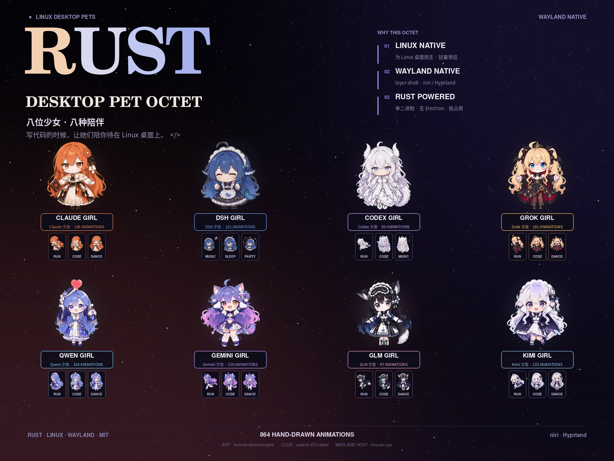
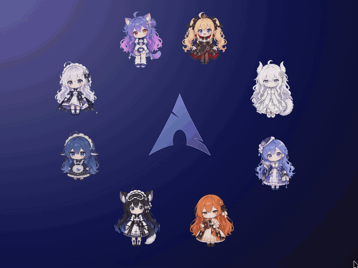

<div align="center">
  
</div>

<div align="center">
  
</div>

<h1 align="center">Rust Desktop Pet Octet</h1>

<p align="center">
  <b>Eight little companions, living natively on your Linux desktop.</b><br>
  <b>八位少女，八种陪伴，原生住在你的 Linux 桌面上。</b>
</p>

<p align="center">
  <code>Rust 2024</code> · <code>Linux</code> · <code>Wayland</code> · <code>layer-shell</code> · <code>864 animations</code> · <code>MIT</code>
</p>

---

## English

### Eight girls, one native Linux desktop

**Rust Desktop Pet Octet** is a collection of eight independent desktop pets for Linux, all written in **Rust** and sharing one engine:

| Pet | Palette | Animations |
| --- | --- | ---: |
| **Claude Girl** | warm orange / copper | 166 |
| **DSH Girl** | deep blue / silver | 101 |
| **Codex Girl** | silver white / violet | 90 |
| **Grok Girl** | pale gold / wine red | 101 |
| **Qwen Girl** | periwinkle / sky blue | 104 |
| **Gemini Girl** | lilac / lavender | 100 |
| **GLM Girl** | pink / charcoal | 97 |
| **Kimi Girl** | white / navy | 105 |

That is **864 ten-second animation clips** in total.

Each pet is a small, transparent, always-on-top **Wayland layer-shell** window that lives at the bottom of the screen. They idle, wander, react when you click them, notice when your battery is low, dance when music is playing, and keep you company while you code.

There is no Electron, no browser engine, no X11 fallback, and no background daemon. Just a small Rust executable and a state machine that tries to feel alive.

### Precompiled `pet`, TUI and on-demand assets

The release entry point is the unified **`pet`** program. It contains no character artwork, so the program archive stays small:

```bash
pet tui                    # choose, download, configure and start a pet
pet run kimi               # download if needed, start in the background and return
pet download kimi          # download and verify one character's original WebP files
pet assets-dir             # print the configured asset root
pet assets-dir /mnt/pet    # use a different asset root
pet stop kimi              # stop that character
pet kimi                   # toggle it
pet kimi size 120          # save and hot-apply the scale
```

Install the latest x86_64 or aarch64 release with one command. The bootstrap script detects the CPU architecture, downloads and verifies the program archive, then performs the same per-user install without sudo:

```bash
curl -fsSL https://raw.githubusercontent.com/linxuan-sys/linux-desktop-pet/main/scripts/install.sh | bash
pet tui
```

To verify and unpack a release manually instead, download `pet-0.1.0-x86_64.tar.gz` or `pet-0.1.0-aarch64.tar.gz` from the [program release](../../releases/latest):

```bash
tar -xzf pet-0.1.0-x86_64.tar.gz
cd pet-0.1.0-x86_64
./install.sh
pet tui
```

Original WebP resources come from the independent [`assets-v1`](../../releases/tag/assets-v1) release. The downloader verifies the manifest, archive and every file with SHA-256, then stores the result under `<assets_root>/pet/assets/<pet>/` for offline reuse. The default root is `$XDG_DATA_HOME` (usually `~/.local/share`); set another root with `pet assets-dir PATH`, or select **素材目录** in the TUI and press Enter. Use `pet assets-dir default` or choose automatic management in the TUI to reset. Existing files stay in the old root, and running pets use the new root after restart. A requested clip is decoded on a background thread, cropped losslessly in memory, and kept in a bounded 32 MiB hot cache by default. The green-screen cleanup markers and original WebP bytes are preserved.

When running from a source checkout, the CLI and TUI use the tracked `<repository>/<pet>/media` directory first, so those original WebP files are neither copied nor downloaded again. A valid `--media-dir` has the highest priority, an existing verified managed cache comes next, and only an installed `pet` with no local copy downloads the requested character. `pet download <pet>` remains the explicit refresh/download command.

The transparent, single-list TUI shows each character's running state, CPU and RSS memory, refreshed every second, plus totals. CPU uses the whole machine as 100% (one fully occupied logical core on a 16-core machine is 6.25%); RSS totals may count shared pages more than once. Tab/Shift+Tab marks a character and moves down/up; Ctrl+A selects filtered results, Ctrl+D clears selections, and `/` searches. Enter opens explicit start/stop/update actions for marked characters, or the cursor character when none are marked. Press `,` for settings; size/cache edits are saved with Enter and cancelled with Esc. Alpha is under advanced settings. The single **素材目录** entry offers automatic discovery or a directory preview: choose a checkout/library root, one character's `media` directory, or an empty download directory. Discovered repository paths are remembered for launches from other working directories. The CLI equivalent for a single character is `pet assets-dir kimi /path/to/kimi-girl/media`; `pet assets-dir default` restores automatic discovery. Existing files are neither copied nor deleted. Local artwork is updated through its checkout/files; downloaded artwork is refreshed through the manifest. Stop a running character before refreshing its downloaded artwork. `pet run <name> --foreground` remains available for debugging.

Each running character also exposes a distinct Linux process name such as
`pet-claude`, `pet-dsh` or `pet-codex`, while the installed executable remains
`pet`.

### Optional per-pet disk frame cache

```bash
pet cache dsh              # show mode, directory and size
pet cache dsh common       # prepare the 8 frequent actions
pet cache dsh all          # prepare every action
pet cache dsh none         # disable and remove generated frame files
```

In the TUI, select characters, open **设置 → 磁盘缓存**, then choose **不缓存 / 常用动作 / 全量缓存**. Preparation runs in the background with progress; the saved mode is hot-applied after it succeeds. **内存缓存** remains a separate setting. Standalone binaries accept `--disk-cache none|common|all`.

Frames live under `$XDG_CACHE_HOME/pet/frames/<pet>/` (default `~/.cache/pet/frames/<pet>/`). The player reads one lossless compressed frame at a time. `common` covers idle, typing, music, dance, walk, drag, happy and copy; other actions use the RAM cache. Switching to `common` removes other generated frames; `none` clears generated frame files. Sources remain unchanged. Source changes invalidate derived files, and corrupt frames are rebuilt. Cache I/O failures are reported and that action uses the RAM path until the mode is changed or the program restarts.

DSH's 8 frequent actions need about 101 MiB; all 101 need about 1.29 GiB. All eight characters together need about 12.72 GiB for this format. Generation still decodes whole sheets once and may take tens of seconds with a higher temporary RAM peak; the lower playback peak applies after generation. `none` is the default.

Downloaded originals are stored at `<assets_root>/pet/assets/<pet>/`, defaulting to `~/.local/share/pet/assets/<pet>/`. Both storage paths have stable names with no version suffix. Version and source identity are metadata inside the files. Old version-named directories are not read, migrated, reused or deleted.

### Release channels

Programs and artwork have separate, immutable release channels:

- `assets-vN` is built from the original WebP files and manifests. Push an `assets-*` tag (or manually run **Release assets**) to package all eight characters, upload them to a draft release, verify their SHA-256 files, and only then publish the release.
- `vX.Y.Z` is built by **Build program-only releases**. It checks that the asset tag in `resources/source.json` is already public, then publishes only the small `pet` programs.

For new artwork, first commit the files and publish the new `assets-vN` release. Then update `resources/source.json`, bump the program version, and publish `vX.Y.Z`. Old asset releases should not be replaced.

### Why Rust, why Linux, why Wayland

**Rust, because a desktop pet should be invisible in the process list.** Every pet uses Rust 2024 and compiles to a single executable of roughly 2.6 MB with `strip`, LTO, and `opt-level = "s"`. There is no garbage collector, no JavaScript runtime, and no bundled browser. The renderer blits one 640×360 RGBA frame into a shared-memory buffer; the sensors run on ordinary threads.

**Linux, because that is where these pets live.** The code talks directly to Linux interfaces: `/proc` for process detection, sysfs for battery state, D-Bus/MPRIS for music, the XDG base directories for config and media, and systemd user services for optional autostart.

**Wayland, because layer-shell is the right primitive.** Each pet creates a `zwlr_layer_shell_v1` overlay surface with a transparent buffer, fractional-scale awareness, click-through transparency, and an input region built from the visible pixels. The tested compositors are **niri** and **Hyprland**; other wlr-layer-shell compositors may work, but focus detection falls back to "no focus information".

### The octet

Every pet shares the same pose vocabulary but has its own rhythm. The click-happy start and the walk movement window are tuned per character so each one reaches her jump and her run at the right moment. Every animation file is still a complete 10-second clip.

| Pet | Directory | Binary | Launcher | Animations | Click-happy clip | Walk movement window |
| --- | --- | --- | --- | ---: | --- | --- |
| **Claude Girl** | `claude-girl/` | `claude-girl` | `pet claude` | 166 | 4.0–10.0 s (6.0 s) | 3.0–5.0 s, 120 px |
| **DSH Girl** | `dsh-girl/` | `dsh-girl` | `pet dsh` | 101 | 3.5–10.0 s (6.5 s) | 1.5–4.5 s, 180 px |
| **Codex Girl** | `codex-girl/` | `codex-girl` | `pet codex` | 90 | 3.0–10.0 s (7.0 s) | 3.0–5.5 s, 150 px |
| **Grok Girl** | `grok-girl/` | `grok-girl` | `pet grok` | 101 | 3.0–10.0 s (7.0 s) | 3.5–5.5 s, 120 px |
| **Qwen Girl** | `qwen-girl/` | `qwen-girl` | `pet qwen` | 104 | 3.0–10.0 s (7.0 s) | 3.5–5.5 s, 120 px |
| **Gemini Girl** | `gemini-girl/` | `gemini-girl` | `pet gemini` | 100 | 2.5–10.0 s (7.5 s) | 3.5–5.5 s, 120 px |
| **GLM Girl** | `glm-girl/` | `glm-girl` | `pet glm` | 97 | 3.0–10.0 s (7.0 s) | 3.0–5.5 s, 150 px |
| **Kimi Girl** | `kimi-girl/` | `kimi-girl` | `pet kimi` | 105 | 2.0–10.0 s (8.0 s) | 3.0–5.5 s, 150 px |

Walking always covers **60 px/s** during the movement window, so a longer window means a longer walk.

### Shared features

- **864 animations.** Each pose is a 5120×5400 WebP sprite sheet: 8 columns × 15 rows, 120 frames of 640×360 at 12 fps, played as one complete 10-second loop.
- **Native Wayland overlay.** `zwlr_layer_shell_v1`, fractional scaling, transparent background, click-through outside the artwork, input region derived from opaque pixels.
- **Terminal awareness.** Focus detection through niri IPC or the Hyprland socket, matched on the focused window's app id against a list of common Linux terminals.
- **A small daily routine.** Work mode runs a fixed 50-second loop: two idle clips, typing, idle, music. Awake mode idles, looks around, picks a random animation, and walks. Between 00:00 and 06:00 she alternates a yawn and a nap instead.
- **Drag reaction.** Grab any pet and hold the pointer: she switches to her "suspended" clip immediately, at the highest priority, and the clock keeps running so the animation does not freeze while the window moves. Release ends the clip at once.
- **Small reactions.** Happy hop on click, celebration when the charger is plugged in, low-battery reminder, dance when MPRIS reports music, quiet "copy" animation when the clipboard changes.
- **Priority, highest first:** drag, clipboard copy, click-happy, music (dance), midnight yawn/sleep, then the work loop or the awake schedule.
- **Walking.** The window moves only during the run window of the clip. Direction cycles two left runs, then two right runs; at a screen edge the window stops and the clip keeps running in place.
- **Readable architecture.** Pet engine, Wayland host and sensors are separate modules. No framework, no runtime, no magic.
- **Configuration and click commands.** A small JSON file maps each mouse button to a terminal command, with a 1200 ms click debounce.

### Requirements

- Linux with a Wayland compositor that supports `zwlr_layer_shell_v1`. **niri** and **Hyprland** are the tested targets. X11 is not supported.
- A precompiled release needs no Rust toolchain. Building from source needs Rust 1.88 or newer because the character crates use edition 2024.
- `pkg-config`, `wayland`, and `wayland-protocols` development files.
- Optional: a working D-Bus session bus for MPRIS music detection.
- Optional: `wl-clipboard` support for the clipboard reaction.

On Arch Linux:

```bash
sudo pacman -S --needed rust pkg-config wayland wayland-protocols
```

### Build

All eight pets share one engine (`engine/`) through a Cargo workspace, so a single command at the repository root builds all of them:

```bash
cd ~/.local/opt/linux-desktop-pet
cargo build --release
```

Build one pet only:

```bash
cargo build --release -p kimi-girl
```

The binaries are written to one shared target directory:

```text
target/release/claude-girl
target/release/dsh-girl
target/release/codex-girl
target/release/grok-girl
target/release/qwen-girl
target/release/gemini-girl
target/release/glm-girl
target/release/kimi-girl
```

### Prepare the animation assets (optional)

Original artwork remains in `<pet>/media/anim/*.webp`; the optional disk frame cache is generated separately. Clone and source runs use
the existing files without copying or generating a multi-gigabyte atlas.

`prepare` remains available as the one-time download and validation entry:

```bash
pet prepare
pet kimi prepare
```

The command checks the original WebP sheets and their `ASSETS.json` processing
marker. It does not rewrite the images or create an `optimized/` directory.
Installed releases download only the selected character on first use and reuse
the verified local copy afterwards.

### Run

```bash
pet claude
pet kimi
```

Running the same command again stops that pet. All eight at once (fish):

```fish
for n in claude dsh codex grok qwen gemini glm kimi
    pet $n
end
```

Without the launcher, point the binary at its media directory:

```bash
./target/release/kimi-girl --media-dir kimi-girl/media
```

Check what is alive, and stop everything:

```bash
pgrep -a -x 'claude-girl|dsh-girl|codex-girl|grok-girl|qwen-girl|gemini-girl|glm-girl|kimi-girl'
pkill -x 'claude-girl|dsh-girl|codex-girl|grok-girl|qwen-girl|gemini-girl|glm-girl|kimi-girl'
```

The launcher staggers the pets along the bottom-right corner when more than one is running (slot 4, 304, 604, … 2104 logical pixels); a single pet parks at the very edge.

> **Screen width.** Eight pets at the default 1.0 scale need about 2756 logical pixels of horizontal room. On a narrower screen they overlap — shrink them with `pet <name> size 60` or run a subset.

### Resize at runtime

```bash
pet kimi size 120
```

`50`–`150` percent. The value is saved to the config file and applied to a running pet within half a second.

### Deploy the launcher (recommended)

Keep the whole repository at:

```text
~/.local/opt/linux-desktop-pet
```

Install the single-file launcher to:

```text
~/.local/bin/pet
```

```bash
install -Dm755 pet ~/.local/bin/pet
```

For a fresh clone (replace `YOUR_REPO_URL`):

```bash
mkdir -p ~/.local/opt ~/.local/bin \
  && git clone YOUR_REPO_URL ~/.local/opt/linux-desktop-pet \
  && install -Dm755 ~/.local/opt/linux-desktop-pet/pet ~/.local/bin/pet
```

The `pet` file in the repository is the source copy. Edit that one and reinstall it; do not edit `~/.local/bin/pet` directly.

Launcher reference:

```text
pet build                       编译全部桌宠
pet <名字> build                只编译该桌宠
pet prepare                     下载并校验全部桌宠素材
pet <名字> prepare              下载并校验该桌宠素材
pet {claude|dsh|codex|grok|qwen|gemini|glm|kimi}   启停该桌宠
pet <名字> size 50..150         设置大小百分比，运行中生效
```

If the repository lives somewhere else, set `PET_ROOT`:

```bash
PET_ROOT=/path/to/linux-desktop-pet pet claude
```

Startup errors are written to `~/.local/state/pet/<name>.log`.

### Install a standalone binary (optional)

Skip this section if you use the `pet` launcher. Install one pet into your user prefix:

```bash
pet=kimi-girl
install -Dm755 "$pet/target/release/$pet" ~/.local/bin/"$pet"
mkdir -p ~/.local/share/"$pet"
cp -r "$pet/media" ~/.local/share/"$pet"/
```

The binary searches for `media/anim` in this order:

1. `$XDG_DATA_HOME/<pet>/media` (usually `~/.local/share/<pet>/media`)
2. `media/` next to the executable
3. `../media`
4. `../../media`
5. `./media`

For autostart, create a user service (replace the name as needed):

```bash
mkdir -p ~/.config/systemd/user
cat > ~/.config/systemd/user/kimi-girl.service <<'SERVICE'
[Unit]
Description=Kimi Girl desktop pet
After=graphical-session.target
PartOf=graphical-session.target

[Service]
ExecStart=%h/.local/bin/kimi-girl
Restart=on-failure

[Install]
WantedBy=graphical-session.target
SERVICE
systemctl --user daemon-reload
systemctl --user enable --now kimi-girl.service
```

### Configuration

All eight pets read one file:

```text
$XDG_CONFIG_HOME/pet/pet.json
# usually ~/.config/pet/pet.json
```

The file is **not created automatically**. Without it every pet runs on its built-in defaults. A ready-to-edit template ships in the repository root:

```bash
mkdir -p ~/.config/pet
cp pet.example.json ~/.config/pet/pet.json
```

`pet <name> size <percent>` also creates the file if it is missing.

Each binary selects `pets.<package-name>` and falls back to built-in defaults for missing keys, so you only need to keep the sections you want to change:

```json
{
  "assets_root": null,
  "pets": {
    "claude-girl": {
      "scale": 1.0,
      "cache_mib": 32,
      "disk_cache": "none",
      "output": null,
      "premultiply": true,
      "click": { "left": "", "middle": "kitty", "right": "kitty claude" }
    },
    "kimi-girl": {
      "scale": 1.0,
      "cache_mib": 32,
      "disk_cache": "none",
      "output": null,
      "premultiply": true,
      "click": { "left": "", "middle": "kitty", "right": "kitty kimi" }
    }
  }
}
```

| Key | Default | Meaning |
| --- | --- | --- |
| `assets_root` | `null` | Global root for downloaded character data. `null` uses `$XDG_DATA_HOME`; a string must be an absolute path or start with `~/`. |
| `scale` | `1.0` | Size multiplier, `0.5`–`1.5`. `1.0` draws one buffer pixel per canvas pixel, i.e. no resampling. |
| `cache_mib` | `32` | RAM clip-cache target in MiB, `16`–`512`, for actions without disk caching. One active clip may exceed it. |
| `disk_cache` | `"none"` | Per-pet frame cache: `none`, `common` (8 frequent actions), or `all`. |
| `output` | `null` | Connector name to pin the pet to, e.g. `"DP-1"`. `null` follows the compositor. |
| `premultiply` | `true` | Premultiply alpha before writing to the shared buffer. Wayland's `Argb8888` is a premultiplied format, so `true` is correct. Set `false` only for artwork whose antialiased edges carry green-screen residue that shows up as dark speckle once premultiplied. |
| `click.left` | `""` | Left-click command. Empty means no command; the click still plays the happy reaction. |
| `click.middle` | `kitty` | Middle-click command. |
| `click.right` | per pet | `kitty claude`, `kitty dsh-tui`, `kitty codex`, `kitty grok`, `kitty qwen`, `kitty agy`, `kitty zcode`, `kitty kimi`. |

The file is polled every 500 ms and applied without restarting. Invalid values are rejected and the last good configuration stays in effect. Window position is remembered across restarts in a separate state file.

Polling intervals are fixed in the binary: system state every 2.5 s, render tick every 16 ms (62.5 Hz). The renderer only presents when the frame actually changes, so the higher tick rate costs nothing while a 12 fps clip is playing.

Commands are split on whitespace and spawned directly, without a shell. If you need pipes or quoting, point the config at a small wrapper script. Click commands are debounced for 1200 ms.

### How it works

```text
sensors (2.5 s) ──► DerivedState ──► Pet state machine ──► pose ──► renderer (16 ms)
focus socket ─────► SharedCache ───┘
clipboard ────────► reaction ──────┘
pointer grab ─────► drag reaction ─┘
```

- **Sensors.** A background thread polls the focused window, MPRIS playback, battery and hour every 2.5 seconds. A compositor-specific thread streams focus events into a shared cache.
- **Pet engine.** Each pose is locked for a complete 10-second clip. Drag, click-happy and clipboard copy interrupt immediately; charging waits for the current clip to finish. Drag is the only reaction driven by a held state rather than a timer.
- **Modes.** With a terminal focused the pet runs a fixed 50-second loop: idle, idle, typing, idle, music. Otherwise it follows the seven-step awake routine: idle, idle, random, idle, idle, random, walk.
- **Walking.** The window is stationary before and after the run window, interpolates its position during the run, and clamps at the screen edges.
- **Renderer.** The unified program keeps the original WebP sheet unchanged, decodes one requested clip on a background thread, crops each frame to its alpha bounds, and retains a bounded lossless hot cache. The source sheet is released after cropping.

Compressed frame buffers discard unused capacity, and the cache budget counts their allocated capacity. On glibc Linux, cold loads and cache evictions also return unused allocator pages to the OS; per-frame cache hits do not trigger this work. `cache_mib` limits retained frame storage, not total process RSS: the allocator may retain fragmented pages, and cold decoding still needs a temporary 105 MiB source image plus decoder workspace.

### Animation format

Each file in `<pet>/media/anim/` is a WebP sprite sheet:

- **5120×5400** pixels, **8 columns × 15 rows**
- **120 frames** of **640×360**, played at **12 fps** = **10 seconds**
- Transparent background; the artwork is padded inside each cell

Pose mapping for the seven "long-name" pets (Claude, DSH, Grok, Qwen, Gemini, GLM, Kimi):

| Pose | Source clip |
| --- | --- |
| `idle` | `待机呼吸休闲` |
| `happy` | `点击回应-开心跃动` (Qwen uses `开心跃动`) |
| `dance` | `可爱宅舞` |
| `typing` | `写代码` |
| `music` | `悠闲哼歌` |
| `walk-left` / `walk-right` | `原地左转奔跑` (right is mirrored) |
| `copy` | `轻快记录` |
| `charging` | `工作状态-雀跃庆祝` (GLM uses `小蓝狐现世`) |
| `low-battery` | `工作状态-垂头叹气冒汗` (Grok/Gemini use `工作状态-思考冒泡`; GLM uses `原地重力下蹲压缩`) |
| `drowsy` / `late-night` | `哈欠连天` |
| `asleep` | `原地小憩沉眠` |
| `dragged` | `被鼠标拖拽悬空反馈` |

Codex Girl uses short clip names throughout: `待机`, `开心`, `跳舞`, `写代码`, `听音乐`, `奔跑`, `记录`, `庆祝`, `没电`, `打哈欠`, `睡觉`, plus `被鼠标拖拽悬空反馈` for dragging.

To add a random animation, put a new WebP in `media/anim/` and add its filename stem to `EASTER_ACTIONS` in `src/pet.rs`. To add a dedicated state, map the new stem in `pose_anim` in `src/character.rs`.

> **Clip names must exist.** A name in `EASTER_ACTIONS` with no matching `<name>.webp` is logged once as `animation <name>: missing from library` and leaves the canvas blank — the pet looks frozen. Always diff the pool against the media directory after adding a new character.

### Project layout

```text
linux-desktop-pet/
├── Cargo.toml                workspace: eight character crates, `desktop-pet`, one engine
├── desktop-pet/              unified CLI and Rust TUI; executable name is `pet`
├── engine/                   shared by all pets
│   ├── assets.rs             versioned download, manifest and SHA-256 verification
│   ├── gfx.rs                original WebP decoding, crop cache and blit
│   ├── runtime.rs            main loop, config hot-reload, drag edges, signal plumbing
│   ├── settings.rs           config parse, atomic write, placement persistence
│   ├── host/
│   │   ├── mod.rs            Host trait, input regions, RGBA→BGRA
│   │   └── wl.rs             layer-shell surface, double buffering, scaling
│   └── sensors/              focus (niri/Hyprland), MPRIS, battery, clipboard
├── claude-girl/              same layout for every pet
│   ├── src/
│   │   ├── main.rs           8 lines: points at ../../engine
│   │   ├── character.rs      pose → animation filename, DEFAULT_PREMULTIPLY
│   │   └── pet.rs            state machine (the only pet-specific logic)
│   └── media/
│       ├── anim/             source WebP sheets (in git)
│       └── ASSETS.json       optional marker: "cleaned" / "raw"
├── dsh-girl/                101 animations
├── codex-girl/               90 animations
├── grok-girl/               101 animations
├── qwen-girl/               104 animations
├── gemini-girl/             100 animations
├── glm-girl/                 97 animations
├── kimi-girl/               105 animations
├── docs/
│   ├── poster.png            the octet poster
│   └── demo.gif              demo recording
├── resources/source.json     independent resource repository and release tag
├── scripts/                  program/resource packaging and release helpers
├── pet                       source-tree wrapper for the unified `pet`
├── pet.example.json          config template — copy to ~/.config/pet/pet.json
├── LICENSE
└── README.md
```

Adding a ninth character means one new crate with three files — `main.rs`, `character.rs` and `pet.rs` — plus its media directory and registry entries in `desktop-pet` and `Cargo.toml`. No engine changes.

### Troubleshooting

- **`expected 5120x5400 source sheet`** — the selected file is not a
  complete original animation sheet. Restore it with `pet <name> prepare`.
- **`animation <name>: missing from library`** — a name in `EASTER_ACTIONS` has no matching WebP. Remove it from the pool or add the asset.
- **`no media/anim directory`** — pass `--media-dir <pet>/media`, or install `media/` into `~/.local/share/<pet>/media`.
- **The pet is invisible or the layer never appears** — check that you are on Wayland and that your compositor supports `zwlr_layer_shell_v1`.
- **Nothing happens under X11** — X11 is not supported. This is a Wayland-native application.
- **Focus reactions do not fire** — focus detection is implemented for niri and Hyprland.
- **No music reaction** — make sure the player exposes MPRIS on the session bus.
- **No clipboard reaction** — make sure `wl-clipboard` support is available.
- **The pets overlap** — they are independent windows. Eight at 1.0 scale need ~2756 logical px; shrink them with `pet <name> size 60` or run fewer.
- **The pet looks frozen while dragging** — the drag clip is selected from the pointer-down edge. If the compositor drops the release event, restart the pet.
- **Dark speckle around the artwork** — set `"premultiply": false` for that pet.

### License

The source code in this repository is released under the **MIT License** — see [LICENSE](LICENSE).

**Asset notice.** The character artwork and animation frames in `*/media/anim/` are **not** covered by the MIT license. They come from the [aboutme-pets](https://github.com/hunmer/aboutme-pets) project. Please follow the upstream asset terms; for public redistribution, credit the upstream project. Do not use the artwork commercially without permission.

### Credits

- **Original concept and static-pose state machine:** [adarsh-67r/clawd](https://github.com/adarsh-67r/clawd) (MIT). These pets began as a port of clawd's state machine from static PNG poses to 10-second WebP clips.
- **Character art and animation clips:** [hunmer/aboutme-pets](https://github.com/hunmer/aboutme-pets). All eight pets use that project's spritesheets (Claude, DSH, Codex, Grok, Qwen, Gemini, GLM, Kimi).
- **Codex / DSH asset cleanup, body-matte repair and loop-seam blending:** [@tingfeng347](https://github.com/tingfeng347) — PR #2 in this repository.
- **Rust ecosystem:** `wayland-client`, `wayland-protocols`, `wayland-protocols-wlr`, `zbus`, `image`, `wl-clipboard-rs`, `webp`, `serde`, `chrono`, `tempfile`.
- The poster is composited from the projects' own animation frames.

---

## 中文

### 八位少女，一个原生 Linux 桌面

**Rust 桌宠八重奏** 是八个独立的 Linux 桌面宠物，全部用 **Rust** 编写，共用同一套引擎：

| 桌宠 | 主色调 | 动画数量 |
| --- | --- | ---: |
| **Claude Girl** | 暖橙 / 铜色 | 166 |
| **DSH Girl** | 深海蓝 / 银色 | 101 |
| **Codex Girl** | 银白 / 紫色 | 90 |
| **Grok Girl** | 淡金 / 酒红 | 101 |
| **Qwen Girl** | 长春花蓝 / 天蓝 | 104 |
| **Gemini Girl** | 丁香紫 / 薰衣草 | 100 |
| **GLM Girl** | 粉色 / 炭黑 | 97 |
| **Kimi Girl** | 白 / 藏青 | 105 |

合计 **864 段 10 秒动画**。

每只桌宠都是一个透明、置顶的 **Wayland layer-shell** 窗口，常驻在屏幕底部。她们会发呆、会散步、被点击时会开心跳一下、电量低时会提醒你、有音乐时会跳舞，也会在你写代码时安静陪着你。

没有 Electron，没有浏览器内核，没有 X11 兜底，也没有后台守护进程。只有一个小型 Rust 可执行文件，和一个努力让自己“活着”的状态机。

### 预先编译的 `pet`、TUI 与按需素材

发行入口是统一的 **`pet`** 程序。程序包不包含角色美术，因此安装包很小：

```bash
pet tui                    # 选择、下载、设置并启停桌宠
pet run kimi               # 首次使用时下载，后台启动后立即返回
pet download kimi          # 下载并校验该角色的原始 WebP
pet assets-dir             # 查看素材存储根目录
pet assets-dir /mnt/pet    # 修改素材存储根目录
pet stop kimi              # 停止该角色
pet kimi                   # 启停切换
pet kimi size 120          # 保存并热应用大小
```

用下面一条命令安装最新程序。脚本会自动识别 x86_64/aarch64、下载并校验 SHA-256、解压，然后执行同一个不需要 sudo 的用户级安装：

```bash
curl -fsSL https://raw.githubusercontent.com/linxuan-sys/linux-desktop-pet/main/scripts/install.sh | bash
pet tui
```

如果需要手动校验和安装，也可以从 [程序 Release](../../releases/latest) 下载 `pet-0.1.0-x86_64.tar.gz` 或 `pet-0.1.0-aarch64.tar.gz`：

```bash
tar -xzf pet-0.1.0-x86_64.tar.gz
cd pet-0.1.0-x86_64
./install.sh
pet tui
```

原始 WebP 从独立的 [`assets-v1`](../../releases/tag/assets-v1) Release 按需下载。下载器通过清单、压缩包和逐文件 SHA-256 校验，保存到 `<素材根目录>/pet/assets/<角色>/`，之后可离线复用。默认根目录是 `$XDG_DATA_HOME`（通常是 `~/.local/share`）；可用 `pet assets-dir 目录`，或在 TUI 中选择 **素材目录** 后按 Enter 修改。用 `pet assets-dir default` 或在 TUI 选择“自动管理”恢复默认。原有文件不会自动搬走，运行中的桌宠重启后使用新目录。需要播放的片段在后台线程中解码，在内存里无损裁剪，默认保留 32 MiB 热缓存；原始 WebP 字节和绿幕清理标记都保持不变。

从源码仓库运行时，CLI 和 TUI 会优先直接使用仓库中已有的 `<仓库>/<角色>/media`，不会复制或重复下载这些原始 WebP。有效的 `--media-dir` 优先级最高，其次是仓库素材和已校验的受管缓存；只有没有本地素材的安装版 `pet` 才会按需下载。`pet download <角色>` 仍可显式下载或刷新素材。

透明的单列 TUI 每秒刷新各角色的运行状态、CPU 和 RSS 内存，并显示总计。CPU 以整机总算力为 100%（例如 16 个逻辑核心中占满一个核心显示 6.25%）；RSS 总计可能重复计算共享页。Tab/Shift+Tab 勾选并向下/向上移动，Ctrl+A 全选筛选结果，Ctrl+D 清空勾选，`/` 搜索。Enter 为勾选伙伴打开明确的启动、停止和更新操作；未勾选时操作光标伙伴。按 `,` 进入设置，大小和缓存支持调整或输入，Enter 保存、Esc 取消；Alpha 放在高级设置中。统一的 **素材目录** 入口提供自动管理和目录预览，可选择仓库/素材库根目录、单角色 `media` 或空的下载目录。发现的仓库路径会被记住，从其他目录启动也可复用。单角色 CLI 配置为 `pet assets-dir kimi /path/to/kimi-girl/media`，`pet assets-dir default` 恢复自动管理。已有文件不复制、不删除。本地素材通过更新仓库或替换文件更新；已下载素材通过远端清单检查更新，更新前需停止对应伙伴。排查时仍可运行 `pet run <角色> --foreground`。

运行中的角色会使用独立的 Linux 进程名，例如 `pet-claude`、`pet-dsh`、
`pet-codex`；安装的可执行文件本身仍然叫 `pet`。

### 每角色可选的磁盘分帧缓存

```bash
pet cache dsh              # 查看档位、目录与占用
pet cache dsh common       # 生成常用 8 动作
pet cache dsh all          # 生成全部动作
pet cache dsh none         # 关闭并清理生成的分帧缓存
```

TUI 中选中伙伴后，进入 **设置 → 磁盘缓存**，选择 **不缓存 / 常用动作 / 全量缓存**。支持为每只角色分别设置，也支持批量选中；后台生成时显示进度，成功后保存并热应用。原来的 MiB 预算改称 **内存缓存**，两者独立。独立角色二进制可使用 `--disk-cache none|common|all`。

分帧缓存放在 `$XDG_CACHE_HOME/pet/frames/<角色>/`，默认 `~/.cache/pet/frames/<角色>/`。播放时只读取并无损解压所需帧。常用动作包含待机、打字、听音乐、跳舞、走路、拖拽、开心、复制；其他动作仍走内存缓存。切回“常用动作”会清理其他生成帧，选择“不缓存”会清理生成文件，原始 WebP 不变。源素材变化后缓存失效，损坏帧自动重建；缓存读写失败会提示原因，该动作暂时走内存路径，改换档位或重启后可重新尝试。

以当前素材计，DSH 常用 8 动作约 101 MiB，全量 101 动作约 1.29 GiB；八角色全量缓存约 12.72 GiB。首次生成仍需解码整张图，可能耗时几十秒并暂时占用较多内存；生成完成后播放才获得较低峰值。默认不启用磁盘缓存。

下载的原始素材直接放在 `<素材根目录>/pet/assets/<角色>/`，默认 `~/.local/share/pet/assets/<角色>/`。素材和缓存目录均不带版本标签，版本及来源指纹只存在文件内部。旧的带版本号目录不读取、不兼容、不迁移、不复用，也不会删除。

### 发布通道

程序和素材使用两条分开的、不可变的 Release 通道：

- `assets-vN` 保存原始 WebP 和清单。推送 `assets-*` 标签（或手动运行 **Release assets**）会把八只角色分别打包，上传到草稿 Release，校验 SHA-256，全部成功后才公开。
- `vX.Y.Z` 由 **Build program-only releases** 构建。它会先确认 `resources/source.json` 引用的素材版本已经公开，然后只发布很小的 `pet` 程序包。

素材更新时，先提交文件并发布新的 `assets-vN`；随后更新 `resources/source.json`、提升程序版本，再发布 `vX.Y.Z`。已经公开的旧素材 Release 不应覆盖。

### 为什么是 Rust，为什么是 Linux，为什么是 Wayland

**用 Rust，因为桌宠不该出现在进程列表的存在感里。** 八只桌宠都使用 Rust 2024，开启 `strip`、LTO 和 `opt-level = "s"` 后，每只约为 2.6 MB 的单文件可执行程序。没有垃圾回收器，没有 JavaScript 运行时，也没有捆绑浏览器。渲染器只把一帧 640×360 的 RGBA 画面送进共享内存缓冲区，传感器跑在普通线程上。

**为 Linux，因为这些桌宠就住在这里。** 代码直接使用 Linux 接口：`/proc` 识别进程，sysfs 读取电池，D-Bus/MPRIS 获取音乐，XDG 目录读取配置和素材，systemd 用户服务负责可选的开机自启。

**原生 Wayland，因为 layer-shell 才是正确的底层原语。** 每只桌宠创建一个 `zwlr_layer_shell_v1` 覆盖层，使用透明缓冲区，支持分数缩放；透明区域可以点击穿透，输入区域只跟随实际可见的像素。已验证的合成器是 **niri** 和 **Hyprland**；其他支持 wlr-layer-shell 的合成器可能可用，但焦点检测会退化成“没有焦点信息”。

### 八只桌宠

所有桌宠共用同一套姿势词汇，但每套动画的节奏不同。点击开心的起点和奔跑移动窗口分别调过，保证每个角色在合适的时间起跳、起跑。每个动画文件本身仍然是完整的 10 秒片段。

| 桌宠 | 目录 | 二进制 | 启动命令 | 动画数量 | 点击开心片段 | 奔跑移动窗口 |
| --- | --- | --- | --- | ---: | --- | --- |
| **Claude Girl** | `claude-girl/` | `claude-girl` | `pet claude` | 166 | 4.0–10.0 秒（6.0 秒） | 3.0–5.0 秒，120 像素 |
| **DSH Girl** | `dsh-girl/` | `dsh-girl` | `pet dsh` | 101 | 3.5–10.0 秒（6.5 秒） | 1.5–4.5 秒，180 像素 |
| **Codex Girl** | `codex-girl/` | `codex-girl` | `pet codex` | 90 | 3.0–10.0 秒（7.0 秒） | 3.0–5.5 秒，150 像素 |
| **Grok Girl** | `grok-girl/` | `grok-girl` | `pet grok` | 101 | 3.0–10.0 秒（7.0 秒） | 3.5–5.5 秒，120 像素 |
| **Qwen Girl** | `qwen-girl/` | `qwen-girl` | `pet qwen` | 104 | 3.0–10.0 秒（7.0 秒） | 3.5–5.5 秒，120 像素 |
| **Gemini Girl** | `gemini-girl/` | `gemini-girl` | `pet gemini` | 100 | 2.5–10.0 秒（7.5 秒） | 3.5–5.5 秒，120 像素 |
| **GLM Girl** | `glm-girl/` | `glm-girl` | `pet glm` | 97 | 3.0–10.0 秒（7.0 秒） | 3.0–5.5 秒，150 像素 |
| **Kimi Girl** | `kimi-girl/` | `kimi-girl` | `pet kimi` | 105 | 2.0–10.0 秒（8.0 秒） | 3.0–5.5 秒，150 像素 |

奔跑窗口内始终是 **60 像素/秒**，所以窗口越长走得越远。

### 共同特性

- **864 段动画。** 每个姿势是一张 5120×5400 的 WebP 精灵图：8 列 × 15 行，120 帧 640×360，12 fps，完整播放 10 秒。
- **原生 Wayland 覆盖层。** `zwlr_layer_shell_v1`、分数缩放、透明背景、画面外点击穿透，输入区域由不透明像素决定。
- **感知终端。** 通过 niri IPC 或 Hyprland socket 读取焦点窗口的 app id，和常见 Linux 终端名单比对。
- **自己的小日常。** 工作模式固定 50 秒循环：两段发呆、一段写代码、一段发呆、一段听音乐。清醒模式发呆、东张西望、随机做动作、起身散步。00:00–06:00 之间改为哈欠和睡觉轮流播放。
- **拖拽反应。** 按住拖动任意一只桌宠，她立刻切到“悬空反馈”片段，优先级最高；时钟继续走，所以窗口移动时动画不会冻结。松手立刻结束该片段。
- **小小的反应。** 点击开心跳、插电源庆祝、低电量提醒、MPRIS 有音乐时跳舞、剪贴板变化时安静“记录”。
- **优先级从高到低：** 拖拽、复制剪贴板、点击开心、音乐播放（跳舞）、0 点后打哈欠再睡、工作循环或清醒日程。
- **走路。** 只在动画的奔跑窗口移动；方向循环是两次左跑、两次右跑；碰到屏幕边缘会 clamp，窗口停住但动画继续原地踏步。
- **可读的架构。** 宠物引擎、Wayland 宿主、传感器各自独立；没有框架、没有运行时、没有魔法。
- **配置与点击命令。** 一个 JSON 把每个鼠标键映射到终端命令，点击有 1200 毫秒防抖。

### 环境要求

- Linux + 支持 `zwlr_layer_shell_v1` 的 Wayland 合成器。**niri** 和 **Hyprland** 是已验证目标。不支持 X11。
- 预编译发行包不需要 Rust；从源码构建需要 Rust 1.88 或更新版本，因为角色 crate 使用 edition 2024。
- `pkg-config`、`wayland`、`wayland-protocols` 开发文件。
- 可选：可用的 D-Bus 会话总线，用于 MPRIS 音乐检测。
- 可选：`wl-clipboard` 支持，用于剪贴板反应。

Arch Linux：

```bash
sudo pacman -S --needed rust pkg-config wayland wayland-protocols
```

### 编译

八只桌宠通过 Cargo workspace 共用同一份引擎（`engine/`），所以在仓库根目录一条命令就能全部编译：

```bash
cd ~/.local/opt/linux-desktop-pet
cargo build --release
```

只编译一只：

```bash
cargo build --release -p kimi-girl
```

产物在同一个 target 目录下：

```text
target/release/claude-girl
target/release/dsh-girl
target/release/codex-girl
target/release/grok-girl
target/release/qwen-girl
target/release/gemini-girl
target/release/glm-girl
target/release/kimi-girl
```

### 准备动画素材（可选）

所有渲染器都直接使用 `<pet>/media/anim/*.webp`。从源码仓库运行时不会复制
素材，也不会生成数 GiB 的额外图集。

`prepare` 继续作为一次性的下载与校验入口：

```bash
pet prepare
pet kimi prepare
```

该命令检查原始 WebP 尺寸和 `ASSETS.json` 处理标记，不重写图片，也不创建
`optimized/` 目录。安装版首次使用时只下载所选角色，之后复用已校验的本地副本。

### 运行

```bash
pet claude
pet kimi
```

同一个命令再执行一次就是关闭对应桌宠。一次开全部八只（fish）：

```fish
for n in claude dsh codex grok qwen gemini glm kimi
    pet $n
end
```

不用启动脚本的话，手动指定素材目录：

```bash
./target/release/kimi-girl --media-dir kimi-girl/media
```

查看在跑哪些，全部关闭：

```bash
pgrep -a -x 'claude-girl|dsh-girl|codex-girl|grok-girl|qwen-girl|gemini-girl|glm-girl|kimi-girl'
pkill -x 'claude-girl|dsh-girl|codex-girl|grok-girl|qwen-girl|gemini-girl|glm-girl|kimi-girl'
```

多只在跑时，启动脚本会沿右下角依次错开（槽位 4、304、604……2104 逻辑像素）；只有一只时贴最右边。

> **屏幕宽度。** 八只在默认 1.0 缩放下需要约 2756 逻辑像素的横向空间。屏幕更窄时会重叠，用 `pet <名字> size 60` 缩小，或者只跑其中几只。

### 运行时调大小

```bash
pet kimi size 120
```

`50`–`150` 百分比。数值会写进配置文件，半秒内对运行中的桌宠生效。

### 部署启动脚本（推荐）

仓库放在：

```text
~/.local/opt/linux-desktop-pet
```

启动脚本装到：

```text
~/.local/bin/pet
```

```bash
install -Dm755 pet ~/.local/bin/pet
```

全新克隆一条命令搞定（把 `YOUR_REPO_URL` 换成你的仓库地址）：

```bash
mkdir -p ~/.local/opt ~/.local/bin \
  && git clone YOUR_REPO_URL ~/.local/opt/linux-desktop-pet \
  && install -Dm755 ~/.local/opt/linux-desktop-pet/pet ~/.local/bin/pet
```

仓库里的 `pet` 是源文件。要改就改它然后重新安装，不要直接改 `~/.local/bin/pet`。

启动脚本用法：

```text
pet build                       编译全部桌宠
pet <名字> build                只编译该桌宠
pet prepare                     下载并校验全部桌宠素材
pet <名字> prepare              下载并校验该桌宠素材
pet {claude|dsh|codex|grok|qwen|gemini|glm|kimi}   启停该桌宠
pet <名字> size 50..150         设置大小百分比，运行中生效
```

如果项目放在别处，用 `PET_ROOT` 指定：

```bash
PET_ROOT=/path/to/linux-desktop-pet pet claude
```

启动失败的日志在 `~/.local/state/pet/<name>.log`。

### 安装单只二进制（可选）

如果你使用上面的 `pet` 启动脚本，可以跳过这一节。把一只桌宠装进用户目录：

```bash
pet=kimi-girl
install -Dm755 "$pet/target/release/$pet" ~/.local/bin/"$pet"
mkdir -p ~/.local/share/"$pet"
cp -r "$pet/media" ~/.local/share/"$pet"/
```

二进制按以下顺序查找 `media/anim`：

1. `$XDG_DATA_HOME/<pet>/media`（通常是 `~/.local/share/<pet>/media`）
2. 可执行文件旁边的 `media/`
3. `../media`
4. `../../media`
5. `./media`

想让桌宠随图形会话启动，创建 systemd 用户服务（名字按需替换）：

```bash
mkdir -p ~/.config/systemd/user
cat > ~/.config/systemd/user/kimi-girl.service <<'SERVICE'
[Unit]
Description=Kimi Girl desktop pet
After=graphical-session.target
PartOf=graphical-session.target

[Service]
ExecStart=%h/.local/bin/kimi-girl
Restart=on-failure

[Install]
WantedBy=graphical-session.target
SERVICE
systemctl --user daemon-reload
systemctl --user enable --now kimi-girl.service
```

### 配置

八只桌宠共用一份配置：

```text
$XDG_CONFIG_HOME/pet/pet.json
# 通常是 ~/.config/pet/pet.json
```

这个文件**不会自动生成**。没有它时每只桌宠都跑内置默认值。仓库根目录带了一份可直接改的模板：

```bash
mkdir -p ~/.config/pet
cp pet.example.json ~/.config/pet/pet.json
```

`pet <名字> size <百分比>` 在文件缺失时也会顺手创建它。

每个二进制只读 `pets.<包名>` 这一节，缺的键回退到内置默认值，所以只写你想改的段就够了：

```json
{
  "assets_root": null,
  "pets": {
    "claude-girl": {
      "scale": 1.0,
      "cache_mib": 32,
      "disk_cache": "none",
      "output": null,
      "premultiply": true,
      "click": { "left": "", "middle": "kitty", "right": "kitty claude" }
    },
    "kimi-girl": {
      "scale": 1.0,
      "cache_mib": 32,
      "disk_cache": "none",
      "output": null,
      "premultiply": true,
      "click": { "left": "", "middle": "kitty", "right": "kitty kimi" }
    }
  }
}
```

| 键 | 默认值 | 含义 |
| --- | --- | --- |
| `assets_root` | `null` | 全局素材数据根目录。`null` 使用 `$XDG_DATA_HOME`；字符串必须是绝对路径或以 `~/` 开头。 |
| `scale` | `1.0` | 大小倍数，`0.5`–`1.5`。`1.0` 表示一个缓冲区像素对应一个画布像素，即不重采样。 |
| `cache_mib` | `32` | 未使用磁盘缓存的动作所用的内存预算（MiB），`16`–`512`；单个动作可能暂时超出目标值。 |
| `disk_cache` | `"none"` | 每角色独立的磁盘缓存：`none` 不缓存、`common` 常用 8 动作、`all` 全量。 |
| `output` | `null` | 固定到某个输出，例如 `"DP-1"`。`null` 跟随合成器。 |
| `premultiply` | `true` | 写入共享缓冲区前是否预乘 alpha。Wayland 的 `Argb8888` 本身就是预乘格式，所以 `true` 才是正确的。只有当素材抗锯齿边缘带有绿幕残留（预乘后会变成暗色雪花）时才设为 `false`。 |
| `click.left` | `""` | 左键命令。留空表示不执行命令，但仍然会播开心反应。 |
| `click.middle` | `kitty` | 中键命令。 |
| `click.right` | 每只不同 | `kitty claude`、`kitty dsh-tui`、`kitty codex`、`kitty grok`、`kitty qwen`、`kitty agy`、`kitty zcode`、`kitty kimi`。 |

配置每 500 毫秒轮询一次，改完不用重启。非法值会被拒绝，上一份可用配置继续生效。窗口位置单独存在状态文件里，重启后恢复。

轮询间隔写死在二进制里：系统状态 2.5 秒一次，渲染 tick 16 毫秒一次（62.5 Hz）。渲染器只在画面真的变了才提交，所以 12 fps 动画播放时更高的 tick 频率并不额外耗电。

命令按空白拆分后直接启动，不经过 shell。需要管道或引号就指向一个小包装脚本。点击命令有 1200 毫秒防抖。

### 工作原理

```text
传感器（2.5 秒）──► DerivedState ──► 桌宠状态机 ──► 姿势 ──► 渲染器（16 毫秒）
焦点 socket ──────► SharedCache ───┘
剪贴板 ───────────► 反应 ──────────┘
指针按住 ─────────► 拖拽反应 ──────┘
```

- **传感器。** 后台线程每 2.5 秒轮询一次焦点窗口、MPRIS 播放状态、电池和小时数。合成器专用线程把焦点事件流进共享缓存。
- **桌宠引擎。** 每个姿势锁定完整的 10 秒片段。拖拽、点击开心、复制剪贴板会立刻打断；充电要等当前片段播完。拖拽是唯一由“按住状态”驱动、而不是定时器的反应。
- **模式。** 聚焦终端时跑固定 50 秒循环：发呆、发呆、写代码、发呆、听音乐。否则走七步清醒日程：发呆、发呆、随机、发呆、发呆、随机、走路。
- **走路。** 奔跑窗口之前和之后窗口不动，窗口内插值移动，碰到屏幕边缘 clamp。
- **渲染器。** 统一程序保持原始 WebP 不变，在后台线程一次解码一个所需动作，把每帧裁到 alpha 边界，并保留有上限的无损热缓存；裁剪完成后即释放完整源图。

压缩帧会收缩多余容量，缓存预算按实际分配容量统计。在使用 glibc 的 Linux 上，首次加载动作和缓存淘汰还会将分配器中的空闲页归还系统；逐帧命中缓存时不执行回收。`cache_mib` 限制的是保留的帧数据，并非进程 RSS 总上限：碎片化页面可能继续驻留，冷解码仍需要临时的 105 MiB 源图及解码器工作内存。

可单独运行真实素材的内存回归检查（连续切换 16 个 DSH 动作，使用 16 MiB 缓存预算）：

```bash
cargo test -p desktop-pet real_clip_switches_keep_resident_memory_bounded -- --ignored --nocapture
```

### 动画格式

`<pet>/media/anim/` 里每个文件都是一张 WebP 精灵图：

- **5120×5400** 像素，**8 列 × 15 行**
- **120 帧**，每帧 **640×360**，**12 fps** 播放 = **10 秒**
- 透明背景；美术内容在格子里有留白

七只“长名字”桌宠（Claude、DSH、Grok、Qwen、Gemini、GLM、Kimi）的姿势映射：

| 姿势 | 源片段 |
| --- | --- |
| `idle` | `待机呼吸休闲` |
| `happy` | `点击回应-开心跃动`（Qwen 用 `开心跃动`） |
| `dance` | `可爱宅舞` |
| `typing` | `写代码` |
| `music` | `悠闲哼歌` |
| `walk-left` / `walk-right` | `原地左转奔跑`（右跑是镜像） |
| `copy` | `轻快记录` |
| `charging` | `工作状态-雀跃庆祝`（GLM 用 `小蓝狐现世`） |
| `low-battery` | `工作状态-垂头叹气冒汗`（Grok/Gemini 用 `工作状态-思考冒泡`；GLM 用 `原地重力下蹲压缩`） |
| `drowsy` / `late-night` | `哈欠连天` |
| `asleep` | `原地小憩沉眠` |
| `dragged` | `被鼠标拖拽悬空反馈` |

Codex Girl 全程用短名字：`待机`、`开心`、`跳舞`、`写代码`、`听音乐`、`奔跑`、`记录`、`庆祝`、`没电`、`打哈欠`、`睡觉`，拖拽用 `被鼠标拖拽悬空反馈`。

想加一个随机动作，把新的 WebP 放进 `media/anim/`，再把文件名主干加进 `src/pet.rs` 的 `EASTER_ACTIONS`。想加一个专用状态，就在 `src/character.rs` 的 `pose_anim` 里映射新的主干名。

> **片段名必须真实存在。** `EASTER_ACTIONS` 里写了名字却没有对应的 `<名字>.webp`，启动后会打印一次 `animation <名字>: missing from library`，画布留空——表现就是桌宠“卡住不动”。新增角色后一定要拿池子和素材目录对一遍。

### 项目结构

```text
linux-desktop-pet/
├── Cargo.toml                workspace：八个角色 crate、`desktop-pet`、一份共享引擎
├── desktop-pet/              统一 CLI 和 Rust TUI；可执行文件名为 `pet`
├── engine/                   所有桌宠共用
│   ├── assets.rs             带版本下载、清单和 SHA-256 校验
│   ├── gfx.rs                原始 WebP 解码、裁剪缓存和位块传输
│   ├── runtime.rs            主循环、配置热重载、拖拽边沿、信号管道
│   ├── settings.rs           配置解析、原子写入、位置持久化
│   ├── host/
│   │   ├── mod.rs            Host trait、输入区域、RGBA→BGRA
│   │   └── wl.rs             layer-shell 表面、双缓冲、缩放
│   └── sensors/              焦点（niri/Hyprland）、MPRIS、电池、剪贴板
├── claude-girl/              每只桌宠都是同样的结构
│   ├── src/
│   │   ├── main.rs           8 行：指向 ../../engine
│   │   ├── character.rs      姿势 → 动画文件名、DEFAULT_PREMULTIPLY
│   │   └── pet.rs            状态机（唯一与桌宠相关的逻辑）
│   └── media/
│       ├── anim/             源 WebP 精灵图（进 git）
│       └── ASSETS.json       可选标记："cleaned" / "raw"
├── dsh-girl/                101 段动画
├── codex-girl/               90 段动画
├── grok-girl/               101 段动画
├── qwen-girl/               104 段动画
├── gemini-girl/             100 段动画
├── glm-girl/                 97 段动画
├── kimi-girl/               105 段动画
├── docs/
│   ├── poster.png            八只桌宠的海报
│   └── demo.gif              演示动图
├── resources/source.json     独立素材仓库和 Release 标签
├── scripts/                  程序和素材打包、发布辅助脚本
├── pet                       统一 `pet` 的源码目录包装脚本
├── pet.example.json          配置模板 —— 复制到 ~/.config/pet/pet.json
├── LICENSE
└── README.md
```

加第九只桌宠意味着新建一个 crate（三个文件：`main.rs`、`character.rs`、`pet.rs`）、一个素材目录，以及在 `desktop-pet` 和 `Cargo.toml` 里登记。引擎不用改。

### 常见问题

- **`expected 5120x5400 source sheet`** —— 选中的文件不是完整的原始动画图，
  用 `pet <名字> prepare` 恢复或重新下载。
- **`animation <名字>: missing from library`** —— `EASTER_ACTIONS` 里的名字没有对应的 WebP。从池子里删掉，或者补上素材。
- **`no media/anim directory`** —— 传 `--media-dir <pet>/media`，或者把 `media/` 装进 `~/.local/share/<pet>/media`。
- **桌宠看不见 / 覆盖层没出现** —— 确认在 Wayland 下，且合成器支持 `zwlr_layer_shell_v1`。
- **X11 下毫无反应** —— 不支持 X11，这是原生 Wayland 应用。
- **焦点反应不触发** —— 焦点检测只实现了 niri 和 Hyprland。
- **没有音乐反应** —— 确认播放器在会话总线上暴露了 MPRIS。
- **没有剪贴板反应** —— 确认 `wl-clipboard` 可用。
- **桌宠叠在一起** —— 它们是独立窗口。八只在 1.0 缩放下需要约 2756 逻辑像素；用 `pet <名字> size 60` 缩小，或者少跑几只。
- **拖拽时桌宠像卡住了** —— 拖拽片段由指针按下边沿触发。如果合成器丢了松手事件，重启该桌宠。
- **画面周围有暗色雪花** —— 给那只桌宠设 `"premultiply": false`。

### 许可证

本仓库的源代码以 **MIT 许可证** 发布 —— 见 [LICENSE](LICENSE)。

**素材声明。** `*/media/anim/` 里的角色美术和动画帧**不在** MIT 许可范围内。它们来自 [aboutme-pets](https://github.com/hunmer/aboutme-pets) 项目。请遵循上游素材条款；公开分发时请注明上游项目。未经许可请勿商用。

### 致谢

- **原始概念与静态姿势状态机：** [adarsh-67r/clawd](https://github.com/adarsh-67r/clawd)（MIT）。这些桌宠最初是把 clawd 的状态机从静态 PNG 姿势移植成 10 秒 WebP 片段。
- **角色美术与动画片段：** [hunmer/aboutme-pets](https://github.com/hunmer/aboutme-pets)。八只桌宠都使用该项目的精灵图（Claude、DSH、Codex、Grok、Qwen、Gemini、GLM、Kimi）。
- **Codex / DSH 素材清理、主体透明斑块修复与循环亮度衔接：** [@tingfeng347](https://github.com/tingfeng347) —— 本仓库 PR #2。
- **Rust 生态：** `wayland-client`、`wayland-protocols`、`wayland-protocols-wlr`、`zbus`、`image`、`wl-clipboard-rs`、`webp`、`serde`、`chrono`、`tempfile`。
- 海报由各项目自己的动画帧合成。

## Thanks / 致谢

Eight pets, 864 clips, one shared engine — and a lot of animation frames from the [aboutme-pets](https://github.com/hunmer/aboutme-pets) project.

八只桌宠，864 段动画，一套共享引擎 —— 以及来自 [aboutme-pets](https://github.com/hunmer/aboutme-pets) 的大量动画帧。
