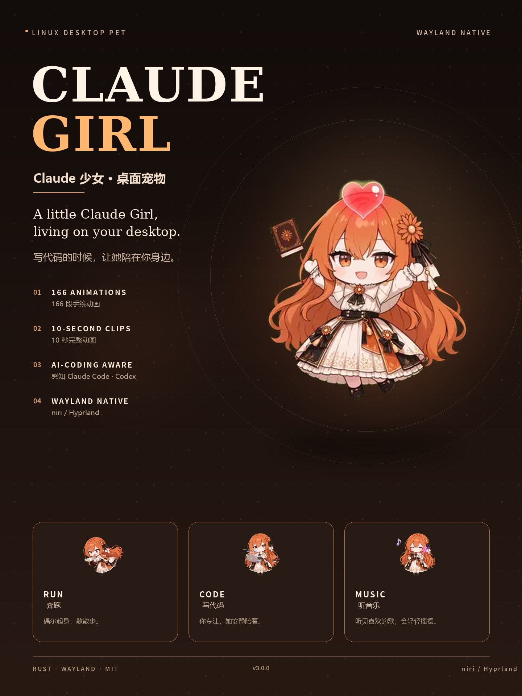

<div align="center">
  
</div>

<h1 align="center">Claude Girl <sub>v3.0.0</sub></h1>

<p align="center">
  <b>A little Claude Girl living on your Linux desktop.</b><br>
  <b>住在你 Linux 桌面上的 Claude Girl。</b>
</p>

<p align="center">
  <code>Rust 2024</code> · <code>Wayland</code> · <code>layer-shell</code> · <code>166 animations</code> · <code>MIT</code>
</p>

---

## English

### Claude Girl, living on your desktop

**Claude Girl** is a native Wayland desktop pet written in Rust. She lives in a transparent, always-on-top layer-shell window at the bottom of your screen: she idles, wanders, reacts to your clipboard, notices when your battery is low, and keeps you company while you code.

No Electron. No browser engine. No X11 fallback. Just a small Rust binary, a library of hand-drawn 10-second animation clips, and a state machine that tries to feel alive.

### Highlights

- **166 hand-drawn animations.** Every pose is a 640×360 sprite sheet, 8×15 frames at 12 fps, played as a complete 10-second loop. No frame is cut in half.
- **Native Wayland, built for niri and Hyprland.** A `zwlr_layer_shell_v1` overlay surface, fractional-scale aware, with click-through transparency and an input region that follows the visible artwork.
- **Aware of your AI coding session.** Focus detection through niri IPC or the Hyprland socket; `/proc` detection for `claude`, `opencode`, and `codex`. When you focus an AI CLI, she switches to work mode.
- **Small reactions that make a difference.** A happy hop on click, a celebration when you plug in, a gentle reminder when the battery is low, a yawn late at night, a little dance when music is playing, and a quiet `copy` animation when you copy something.
- **A small, readable codebase.** The pet engine, the Wayland host, and the sensors are separate modules. No framework, no runtime, no background daemon.

### A day with her

- **Work mode.** When Claude Code, OpenCode, or Codex is focused, she types along, takes a music break every few clips, and dances when Spotify is playing.
- **Awake mode.** When an AI CLI is running but not focused, she follows a relaxed routine: idle, look around, pick a random animation, idle again, wander across the screen.
- **Rest mode.** When no AI CLI is running, she gets drowsy and falls asleep after a short transition.
- **Small things.** Low battery, late night, a charger being plugged in, a clipboard copy — each has its own clip.

### Requirements

- Linux with a Wayland compositor that supports `zwlr_layer_shell_v1`. **niri** and **Hyprland** are the tested targets; other wlr-layer-shell compositors may work, but focus detection falls back to no focus information.
- Rust 1.85+ (the crate uses edition 2024).
- A working D-Bus session bus for MPRIS music detection (optional).
- `wl-clipboard` support for the clipboard reaction (optional).

On Arch Linux:

```bash
sudo pacman -S --needed rust pkg-config wayland wayland-protocols
```

### Build and run

```bash
cd claude-girl
cargo build --release
./target/release/claude-girl
```

The binary searches for `media/anim` in this order:

1. `$XDG_DATA_HOME/claude-girl/media` (usually `~/.local/share/claude-girl/media`)
2. `media/` next to the executable
3. `../media`
4. `../../media`
5. `./media`

Running from the project root finds the bundled `media/anim` directly.

### Install

```bash
install -Dm755 target/release/claude-girl ~/.local/bin/claude-girl
mkdir -p ~/.local/share/claude-girl
cp -r media ~/.local/share/claude-girl/
```

Optional autostart, if your compositor starts `graphical-session.target`:

```bash
mkdir -p ~/.config/systemd/user
cat > ~/.config/systemd/user/claude-girl.service <<'SERVICE'
[Unit]
Description=Claude Girl desktop pet
After=graphical-session.target
PartOf=graphical-session.target

[Service]
ExecStart=%h/.local/bin/claude-girl
Restart=on-failure

[Install]
WantedBy=graphical-session.target
SERVICE
systemctl --user daemon-reload
systemctl --user enable --now claude-girl.service
```

### Configuration

All three pets read one shared file:

```text
$XDG_CONFIG_HOME/desktop-pet/desktop-pet.json
# usually ~/.config/desktop-pet/desktop-pet.json
```

Each binary selects its own section by package name. A minimal file for this pet:

```json
{
  "pets": {
    "claude-girl": {
      "click": {
        "left": "",
        "middle": "kitty",
        "right": "kitty claude"
      }
    }
  }
}
```

The `dsh-girl` and `codex-girl` sections live in the same file. Missing keys fall back to the built-in defaults below.

| Key | Default | Meaning |
| --- | --- | --- |
| `poll.systemState` | `2500` | Sensor poll interval, in milliseconds. |
| `poll.cursor` | `33` | Render tick, in milliseconds. |
| `click.left` | `""` | Left-click command. Empty means no command; the click still plays the happy reaction. |
| `click.middle` | `kitty` | Middle-click command. |
| `click.right` | `kitty claude` | Right-click command. |

Commands are split on whitespace and spawned directly, without a shell. If you need pipes or quoting, point the config at a small wrapper script. Click commands are debounced for 1200 ms, so a burst of clicks cannot open a terminal swarm. The file is read at startup; restart the pet after editing.

### How it works

```text
sensors (2.5 s) ──► DerivedState ──► Pet state machine ──► pose ──► renderer (33 ms)
focus socket ─────► SharedCache ───┘
clipboard ────────► reaction ──────┘
```

- **Sensors.** A background thread polls system state every 2.5 seconds: focused window, CLI process count, MPRIS playback, battery, hour. A compositor-specific thread streams focus events into a shared cache.
- **Pet engine.** The state machine locks each pose for a full 10-second clip. Reactions (happy, charging, copy) can interrupt on click or wait for the current clip to finish. The awake routine is seven steps: idle, idle, random, idle, idle, random, walk.
- **Walking.** A walk is one 10-second clip; the window travels 120 logical pixels during the 3.0–5.0 s run window. The direction cycle is two left runs, then two right runs; a wall shorter than half a stride flips the direction instead of running in place.
- **Renderer.** `Sheet` loads a WebP sprite sheet lazily, keeps a small LRU cache, and blits one 640×360 frame into the shared-memory buffer. The layer surface is transparent; the input region is built from opaque pixels, so clicks only land on the pet.

### Animation format

Each file in `media/anim/` is a WebP sprite sheet:

- **5120×5400** pixels, **8 columns × 15 rows**
- **120 frames** of **640×360**, played at **12 fps** = **10 seconds**
- Transparent background; the visible art is padded inside each cell

The pose-to-file mapping lives in `src/gfx.rs`:

| Pose | Source clip |
| --- | --- |
| `idle` | `待机呼吸休闲` |
| `happy` | `点击回应-开心跃动` |
| `dance` | `可爱宅舞` |
| `typing` | `写代码` |
| `music` | `悠闲哼歌` |
| `walk-left` / `walk-right` | `原地左转奔跑` (right is mirrored) |
| `copy` | `轻快记录` |
| `charging` | `工作状态-雀跃庆祝` |
| `low-battery` | `工作状态-垂头叹气冒汗` |
| `late-night` / `drowsy` | `哈欠连天` |
| `asleep` | `原地小憩沉眠` |

To add a random animation, put a new WebP in `media/anim/` and add its stem to `EASTER_ACTIONS` in `src/pet.rs`. To add a dedicated state, map the new stem in `pose_anim` in `src/gfx.rs`.

### Project layout

```text
src/
  main.rs              entry point, sensor threads, main loop
  pet.rs               pose scheduler and state machine
  gfx.rs               WebP sheet loader and compositor
  host/
    mod.rs             Host trait, input regions
    wl.rs              Wayland layer-shell host
  sensors/
    linux.rs           system state, CLI detection, focus rules
    focus/             niri / Hyprland / fallback focus sources
    mpris.rs           music playback via D-Bus
    battery.rs         battery and charging state
    clipboard.rs       Wayland clipboard watcher
    proc.rs            /proc scanning and config loading
    state.rs           DerivedState
media/anim/            166 WebP animation sheets
docs/poster.png        promotional poster
```

### License and credits

The source code is released under the **MIT License** — see [LICENSE](LICENSE).

**Asset notice.** The character artwork and animation frames in `media/anim/` are **not** covered by the MIT license. They come from the [aboutme-pets](https://github.com/hunmer/aboutme-pets) project. Please follow the upstream asset terms; for public redistribution, credit the upstream project. Do not use the artwork commercially without permission.

Credits:

- Original concept and static-pose state machine: [adarsh-67r/clawd](https://github.com/adarsh-67r/clawd) (MIT).
- Character art and animation clips: [hunmer/aboutme-pets](https://github.com/hunmer/aboutme-pets).
- Built with Rust, `wayland-client`, `zbus`, `image`, `wl-clipboard-rs`, `serde`, and `chrono`.

Claude Girl began as a port of clawd's state machine from static PNG poses to 10-second WebP clips. The poster is composited from the project's own animation frames.

---

## 中文

### 住在你桌面上的 Claude Girl

**Claude Girl** 是一个用 Rust 写的原生 Wayland 桌面宠物。她住在一个透明、置顶的 layer-shell 窗口里，待在屏幕底部：会发呆、会散步、会回应你的剪贴板，会在电量低时提醒你，也会在你写代码时安静陪着你。

没有 Electron，没有浏览器内核，没有 X11 兜底。只有一个小巧的 Rust 二进制、一整套手绘的 10 秒动画，和一个努力让自己“活着”的状态机。

### 亮点

- **166 段手绘动画。** 每个姿势是一张 640×360 的精灵图，8×15 帧、12 fps，完整播放一段 10 秒动画，绝不半路切走。
- **原生 Wayland，为 niri 和 Hyprland 打造。** 使用 `zwlr_layer_shell_v1` 覆盖层，支持分数缩放；透明点击穿透，输入区域跟随实际画面。
- **感知你的 AI 编程状态。** 通过 niri IPC 或 Hyprland socket 读取焦点窗口，通过 `/proc` 识别 `claude`、`opencode`、`codex`。聚焦 AI CLI 时，她会切换到工作模式。
- **恰到好处的小反应。** 点击会开心跳一下；插上电源会庆祝；电量低会提醒；深夜会打哈欠；有音乐时会跟着跳舞；复制内容时会安静地“记录”。
- **小而可读的代码。** 宠物引擎、Wayland 宿主、传感器各自独立；没有框架、没有运行时、没有后台守护进程。

### 她的一天

- **工作模式。** 当你聚焦 Claude Code、OpenCode 或 Codex 时，她会陪着你敲代码；每几段动画会插一段听音乐，Spotify 播放时会跳舞。
- **清醒模式。** 有 AI CLI 在跑但没有聚焦时，她会按自己的节奏生活：发呆、东张西望、随机做点小动作、再发呆，然后起身在桌面上走一走。
- **休息模式。** 没有 AI CLI 在跑时，她会先犯困，再慢慢睡着。
- **小事。** 低电量、深夜、插上电源、复制剪贴板，每种情况都有专属动画。

### 环境要求

- Linux + 支持 `zwlr_layer_shell_v1` 的 Wayland 合成器。**niri** 和 **Hyprland** 是已验证目标；其他 wlr-layer-shell 合成器可能可用，但焦点检测会退化为“无焦点信息”。
- Rust 1.85+（项目使用 edition 2024）。
- 可用的 D-Bus 会话总线，用于 MPRIS 音乐检测（可选）。
- 剪贴板反应需要 `wl-clipboard` 支持（可选）。

Arch Linux：

```bash
sudo pacman -S --needed rust pkg-config wayland wayland-protocols
```

### 构建与运行

```bash
cd claude-girl
cargo build --release
./target/release/claude-girl
```

程序按以下顺序查找 `media/anim`：

1. `$XDG_DATA_HOME/claude-girl/media`（通常是 `~/.local/share/claude-girl/media`）
2. 可执行文件旁边的 `media/`
3. `../media`
4. `../../media`
5. `./media`

在项目根目录直接运行时，会使用仓库自带的 `media/anim`。

### 安装

```bash
install -Dm755 target/release/claude-girl ~/.local/bin/claude-girl
mkdir -p ~/.local/share/claude-girl
cp -r media ~/.local/share/claude-girl/
```

如果你的合成器会启动 `graphical-session.target`，可以选用 systemd 用户服务：

```bash
mkdir -p ~/.config/systemd/user
cat > ~/.config/systemd/user/claude-girl.service <<'SERVICE'
[Unit]
Description=Claude Girl desktop pet
After=graphical-session.target
PartOf=graphical-session.target

[Service]
ExecStart=%h/.local/bin/claude-girl
Restart=on-failure

[Install]
WantedBy=graphical-session.target
SERVICE
systemctl --user daemon-reload
systemctl --user enable --now claude-girl.service
```

### 配置

三只桌宠共用一份配置：

```text
$XDG_CONFIG_HOME/desktop-pet/desktop-pet.json
# 通常是 ~/.config/desktop-pet/desktop-pet.json
```

每只按包名选择自己的段。这只的最小配置示例：

```json
{
  "pets": {
    "claude-girl": {
      "click": {
        "left": "",
        "middle": "kitty",
        "right": "kitty claude"
      }
    }
  }
}
```

`dsh-girl` 和 `codex-girl` 的段也写在同一个文件里。缺失的键会回退到下面的内置默认值。

| 键 | 默认值 | 含义 |
| --- | --- | --- |
| `poll.systemState` | `2500` | 传感器轮询间隔，毫秒。 |
| `poll.cursor` | `33` | 渲染节拍，毫秒。 |
| `click.left` | `""` | 左键命令。空字符串表示不启动程序，但仍然播放点击开心反应。 |
| `click.middle` | `kitty` | 中键命令。 |
| `click.right` | `kitty claude` | 右键命令。 |

命令按空白拆分后直接启动，不经过 shell。如果需要管道或引号，请把配置指向一个小包装脚本。点击命令有 1200 毫秒防抖，连续点击不会开出一堆终端。配置在启动时读取，改完要重启桌宠。

### 工作原理

```text
传感器（2.5 秒）──► DerivedState ──► 宠物状态机 ──► 姿势 ──► 渲染器（33 毫秒）
焦点 socket ──────► SharedCache ───┘
剪贴板 ───────────► 反应 ──────────┘
```

- **传感器。** 后台线程每 2.5 秒采集一次：焦点窗口、CLI 进程数、MPRIS 播放状态、电量、小时。合成器专用线程把焦点事件写入共享缓存。
- **宠物引擎。** 每个姿势锁定一整段 10 秒动画；点击可以立刻打断，充电/复制等反应则等当前片段播完。清醒时的日程是七步：发呆、发呆、随机、发呆、发呆、随机、走路。
- **走路。** 一次走路就是一段 10 秒动画；窗口在 3.0–5.0 秒的奔跑窗口内移动 120 逻辑像素。方向循环是两次左跑、两次右跑；如果离墙不足半个步幅，就自动换方向，而不是原地跑。
- **渲染器。** `Sheet` 按需加载 WebP 精灵图，维护一个小型 LRU 缓存，把一帧 640×360 画进共享内存缓冲区。覆盖层透明，输入区域由不透明像素生成，所以只有点到宠物身上才会响应。

### 动画格式

`media/anim/` 里的每个文件都是一张 WebP 精灵图：

- **5120×5400** 像素，**8 列 × 15 行**
- **120 帧**，每帧 **640×360**，**12 fps** 播放 = **10 秒**
- 透明背景；角色在单元格内留有透明边距

姿势与文件的映射在 `src/gfx.rs`：

| 姿势 | 源动作 |
| --- | --- |
| `idle` | `待机呼吸休闲` |
| `happy` | `点击回应-开心跃动` |
| `dance` | `可爱宅舞` |
| `typing` | `写代码` |
| `music` | `悠闲哼歌` |
| `walk-left` / `walk-right` | `原地左转奔跑`（右侧为镜像） |
| `copy` | `轻快记录` |
| `charging` | `工作状态-雀跃庆祝` |
| `low-battery` | `工作状态-垂头叹气冒汗` |
| `late-night` / `drowsy` | `哈欠连天` |
| `asleep` | `原地小憩沉眠` |

想加入随机动作：把新的 WebP 放进 `media/anim/`，再把文件名（不含扩展名）加到 `src/pet.rs` 的 `EASTER_ACTIONS`。想加入专属状态：在 `src/gfx.rs` 的 `pose_anim` 里建立映射。

### 项目结构

```text
src/
  main.rs              入口、传感器线程、主循环
  pet.rs               姿势调度与状态机
  gfx.rs               WebP 精灵图加载与合成
  host/
    mod.rs             Host trait、输入区域
    wl.rs              Wayland layer-shell 宿主
  sensors/
    linux.rs           系统状态、CLI 检测、焦点规则
    focus/             niri / Hyprland / 兜底焦点源
    mpris.rs           通过 D-Bus 读取音乐状态
    battery.rs         电量与充电状态
    clipboard.rs       Wayland 剪贴板监听
    proc.rs            /proc 扫描与配置加载
    state.rs           DerivedState
media/anim/            166 张 WebP 动画精灵图
docs/poster.png        宣传海报
```

### 许可证与致谢

源代码采用 **MIT 许可证**，详见 [LICENSE](LICENSE)。

**素材声明。** `media/anim/` 中的角色立绘与动画帧**不包含在 MIT 许可内**，素材来自 [aboutme-pets](https://github.com/hunmer/aboutme-pets)。请遵守上游素材条款；公开分发时请署名上游项目；未经许可不得商用。

致谢：

- 原始概念与静态姿势状态机：[adarsh-67r/clawd](https://github.com/adarsh-67r/clawd)（MIT）。
- 角色立绘与动画素材：[hunmer/aboutme-pets](https://github.com/hunmer/aboutme-pets)。
- 使用 Rust、`wayland-client`、`zbus`、`image`、`wl-clipboard-rs`、`serde`、`chrono` 构建。

Claude Girl 最初是把 clawd 的状态机从静态 PNG 姿势移植到 10 秒 WebP 动画的尝试。海报由项目自己的动画帧合成。

---

## Thanks / 致谢

- **Character art & animation — [aboutme-pets](https://github.com/hunmer/aboutme-pets).** Thank you for the beautiful character art and the animation library.
- **Original concept & state machine — [adarsh-67r/clawd](https://github.com/adarsh-67r/clawd).** Thank you for the original desktop pet and the inspiration.

Thank you for letting Claude Girl live on your desktop.
谢谢你把 Claude Girl 留在桌面上。
